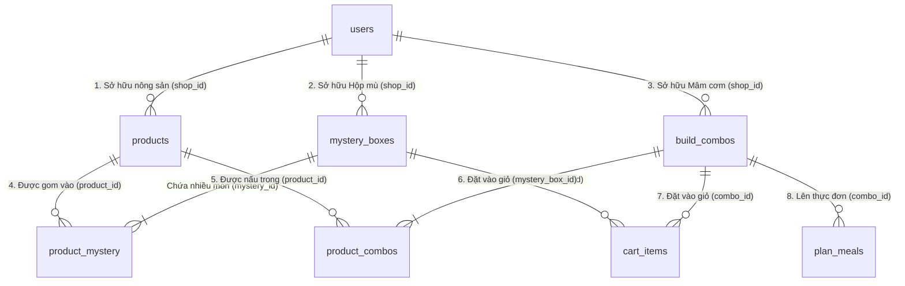

# Tài Liệu Bàn Giao Tính Năng (Handover & API Quick Guide)

> **Dành cho:** Frontend Devs, Mobile Devs, Backend Peers, QA/Tester và Tech Lead.  
> **Nhánh phát triển:** `feature/mystery-box-and-build-combo`  
> **Mục tiêu:** Nắm bắt toàn bộ tính năng, danh sách API, quan hệ bảng CSDL và các lưu ý tích hợp chỉ trong 3-5 phút.

---

## 1. Tổng Quan 3 Tính Năng Đã Xây Dựng

1. **Vòng đời Kiểm duyệt Nông sản (Product Moderation Lifecycle):**
   - Sản phẩm mới tạo hoặc bị sửa tên sẽ ở trạng thái `PENDING` (chờ duyệt) và **bị ẩn** khỏi catalog công khai.
   - Bổ sung 2 API độc quyền cho `ADMIN`: phê duyệt (`approve` $\rightarrow$ `ACTIVE`) hoặc từ chối (`reject` $\rightarrow$ `REJECTED` kèm lý do).
   - Chặn quyền Nông dân (`SHOP`) không được tự kích hoạt sản phẩm.

2. **Hộp Mù Nông Sản Giải Cứu (Mystery Box):**
   - Cho phép Shop gom nhiều loại nông sản `ACTIVE` vào một hộp bí mật với giá ưu đãi.
   - **Cơ chế ẩn danh (Secrecy):** Khách hàng chỉ thấy tên hộp, giá, mô tả, vùng miền; danh sách nông sản thành phần (`items`) bị **ẩn 100% (`null`)**. Chỉ Shop sở hữu mới xem được ruột hộp.
   - Tự động trừ tồn kho nông sản gốc khi tạo, hoàn lại kho khi xóa hộp.

3. **Mâm Cơm / Gói Nông Sản Bữa Ăn (Build Combo):**
   - Cho phép Shop tạo các gói nguyên liệu theo bữa ăn (`MealType`: Sáng, Trưa, Tối, Ăn vặt) và vùng miền ẩm thực (`region`).
   - **Minh bạch 100% (Full Transparency):** Khác với Hộp Mù, mảng `items` của Build Combo được **công khai toàn bộ** để người mua biết rõ công thức và thành phần nguyên liệu.
   - Quản lý trừ/hoàn kho 2 chiều chính xác, hỗ trợ chuyển trạng thái `ACTIVE` / `INACTIVE`.

---

## 2. Danh Sách API Đã Xây Dựng (API nào - Tác dụng gì)

### 2.1. Phân Hệ Kiểm Duyệt Nông Sản (Rescued Product)

| Method | Endpoint | Quyền (Role) | Tác Dụng Nghiệp Vụ | Dữ Liệu Body / Params |
|---|---|:---:|---|---|
| `PATCH` | `/products/{id}/approve` | `ADMIN` | Phê duyệt nông sản chờ duyệt sang `ACTIVE` để mở bán công khai trên sàn. | Không có body. |
| `PATCH` | `/products/{id}/reject` | `ADMIN` | Từ chối nông sản, chuyển sang `REJECTED` và lưu lý do từ chối. | `{"reason": "Ảnh bị mờ, dập úng"}` |
| `PUT` | `/products/{id}` | `SHOP` | Shop cập nhật thông tin sản phẩm. Nếu đổi tên hoặc sửa từ trạng thái `REJECTED` thì tự động về `PENDING`. | JSON thông tin sản phẩm (chặn gửi `status: "ACTIVE"`). |
| `GET` | `/products/my-shop` | `SHOP` | Shop xem danh sách nông sản của chính mình (kèm lọc `status=PENDING/ACTIVE/REJECTED`). | Query: `status`, `page`, `size`. |

---

### 2.2. Phân Hệ Hộp Mù (Mystery Box)

| Method | Endpoint | Quyền (Role) | Tác Dụng Nghiệp Vụ | Đặc Biệt Cho Frontend |
|---|---|:---:|---|---|
| `POST` | `/mystery-boxes` | `SHOP` | Đóng gói hộp mù từ nhiều nông sản `ACTIVE`. Tự động trừ tồn kho nông sản gốc. | Body chứa `boxType`, `price`, `totalQuantity`, mảng `items` (`productId`, `productQuantity`). |
| `GET` | `/mystery-boxes` | Public | Khách xem danh sách hộp mù trên sàn kèm phân trang & lọc (`region`, `keyword`). | **Trường `items` luôn là `null`** (bảo mật hộp mù). |
| `GET` | `/mystery-boxes/{id}` | Public / Shop | Xem chi tiết 1 hộp mù. | Khách xem: `items = null`. Shop chủ hộp xem: `items` hiển thị đầy đủ. |
| `GET` | `/mystery-boxes/my-shop` | `SHOP` | Shop quản lý các hộp mù của mình. | Hiển thị đầy đủ chi tiết nguyên liệu thành phần `items`. |
| `PUT` | `/mystery-boxes/{id}` | `SHOP` | Cập nhật thông tin hộp mù. | Điều chỉnh tồn kho tương ứng. |
| `PATCH`| `/mystery-boxes/{id}/status`| `SHOP` | Bật/tắt kinh doanh (`ACTIVE` / `INACTIVE`). | Query: `status=ACTIVE` hoặc `INACTIVE`. |
| `DELETE`| `/mystery-boxes/{id}` | `SHOP` | Xóa mềm hộp mù $\rightarrow$ **Hoàn trả tồn kho dôi dư chưa bán vào kho gốc**. | Chuyển `isActive = false`, hoàn kho chưa bán, bảo vệ 100% lịch sử đơn hàng và giỏ hàng. |

---

### 2.3. Phân Hệ Mâm Cơm Build Combo

| Method | Endpoint | Quyền (Role) | Tác Dụng Nghiệp Vụ | Đặc Biệt Cho Frontend |
|---|---|:---:|---|---|
| `POST` | `/combos` | `SHOP` | Tạo mâm cơm theo bữa ăn từ các nông sản `ACTIVE`. Trừ kho nông sản gốc. | Body chứa `comboName`, `mealType`, `region`, `totalQuantity`, mảng `items`. |
| `GET` | `/combos` | Public | Khách tìm kiếm, lọc combo theo bữa ăn (`mealType`), vùng miền (`region`). | **Trường `items` hiển thị công khai 100%** cho khách xem nguyên liệu. |
| `GET` | `/combos/{id}` | Public | Xem chi tiết công thức mâm cơm. | Hiển thị tên món, ảnh, và toàn bộ nông sản thành phần bên trong. |
| `GET` | `/combos/my-shop` | `SHOP` | Shop quản lý danh sách mâm cơm của mình. | Quản lý số lượng tồn, số lượng đã bán (`soldQuantity`). |
| `PUT` | `/combos/{id}` | `SHOP` | Sửa giá, mô tả hoặc thay đổi công thức nông sản thành phần. | Tự động cân đối hoàn/trừ độ lệch tồn kho. |
| `PATCH`| `/combos/{id}/status` | `SHOP` | Tạm ẩn / mở bán lại mâm cơm (`ACTIVE` / `INACTIVE`). | Query: `status=ACTIVE` hoặc `INACTIVE`. |
| `DELETE`| `/combos/{id}` | `SHOP` | Xóa mềm mâm cơm $\rightarrow$ **Hoàn trả tồn kho dôi dư chưa bán vào kho gốc**. | Chuyển `status = "INACTIVE"`, hoàn kho chưa bán, bảo vệ 100% lịch sử đơn hàng và giỏ hàng. |

---

## 3. Liên Kết CSDL (Bảng Nào Nối Với Bảng Nào)

### Chi tiết các khóa ngoại liên kết (Foreign Keys):
1. **`users (id)` $\leftrightarrow$ `products (shop_id)` (1 - N):** 1 Nông dân sở hữu nhiều sản phẩm nông sản giải cứu.
2. **`users (id)` $\leftrightarrow$ `mystery_boxes (shop_id)` (1 - N):** 1 Nông dân sở hữu nhiều Hộp Mù.
3. **`users (id)` $\leftrightarrow$ `build_combos (shop_id)` (1 - N):** 1 Nông dân sở hữu nhiều Mâm Cơm / Combo.
4. **Quan hệ N - N giữa `products` và `mystery_boxes` qua bảng trung gian `product_mystery`:**
   - Cột `mystery_id` (FK nối tới `mystery_boxes.mystery_id`).
   - Cột `product_id` (FK nối tới `products.product_id`).
   - Cột `product_quantity`: Định lượng số lượng nông sản này có trong 1 Hộp Mù.
5. **Quan hệ N - N giữa `products` và `build_combos` qua bảng trung gian `product_combos`:**
   - Cột `combo_id` (FK nối tới `build_combos.combo_id`).
   - Cột `product_id` (FK nối tới `products.product_id`).
   - Cột `product_quantity`: Định lượng số lượng nông sản này cần để nấu 1 Mâm Cơm.
6. **Liên kết Giỏ hàng & Kế hoạch ăn uống:**
   - `cart_items` liên kết tới `mystery_boxes` qua `mystery_box_id`, và tới `build_combos` qua `combo_id`.
   - `plan_meals` (Kế hoạch bữa ăn người dùng) liên kết tới `build_combos` qua `combo_id`.

---

## 4. 5 Lưu Ý "Sống Còn" Cho Frontend / Mobile Devs & QA Tester

1. **Khách hàng không thấy sản phẩm `PENDING`:**
   - Khi Shop tạo mới sản phẩm qua `POST /products`, sản phẩm sẽ có trạng thái `PENDING`.
   - Màn hình Catalog của khách hàng (`GET /products`) **sẽ không hiển thị** sản phẩm này cho đến khi ADMIN gọi `PATCH /products/{id}/approve`.
2. **Shop không được tự duyệt `ACTIVE`:**
   - Nông dân gọi `PUT /products/{id}` kèm `"status": "ACTIVE"` sẽ bị hệ thống chặn với mã lỗi `3021 (CANNOT_ACTIVATE_DIRECTLY)`.
   - Nếu nông dân đổi tên sản phẩm (`productName`), hệ thống tự động đưa sản phẩm về lại `PENDING` để kiểm duyệt lại.
3. **Điều kiện gom Hộp Mù & Mâm Cơm:**
   - Tất cả `productId` đưa vào Hộp Mù hoặc Build Combo **bắt buộc phải thuộc sở hữu của chính Shop đó** (nếu không $\rightarrow$ lỗi `5014/6014`) và **đang ở trạng thái `ACTIVE`** (nếu không $\rightarrow$ lỗi `5016/6016`).
   - Tồn kho sản phẩm gốc phải đủ ($\ge \text{productQuantity} \times \text{totalQuantity}$), nếu thiếu sẽ báo lỗi `STOCK_INSUFFICIENT (5015/6015)`.
4. **Khác biệt hiển thị giữa Hộp Mù và Build Combo:**
   - **Mystery Box:** Phía khách hàng chỉ hiển thị thông tin chung, **mảng `items` luôn là `null`**. Frontend không hiển thị chi tiết nông sản để giữ tính bất ngờ cho khách.
   - **Build Combo:** Mảng `items` **luôn hiển thị công khai 100%** cho khách hàng xem công thức nấu ăn.
5. **Cơ chế Xóa Mềm Thông Minh (Smart Soft Delete):**
   - Khi Shop bấm Xóa Hộp Mù hoặc Combo: Hệ thống **tuyệt đối không xóa cứng khỏi CSDL**, mà chuyển trạng thái sang `INACTIVE` (`isActive = false` cho Mystery Box).
   - Hệ thống tự động tính số lượng chưa bán dôi dư ($\text{totalQuantity} - \text{soldQuantity}$) và **hoàn trả 100% về kho nông sản gốc**.
   - Bảo toàn 100% dữ liệu lịch sử hóa đơn (`order_details`) và giỏ hàng (`cart_items`). Trong giỏ hàng của khách hàng, món này sẽ hiển thị nhãn: *"Sản phẩm đã hết hàng / Ngừng kinh doanh"*.
6. **Tự động Cascade Tạm Dừng Khi Nông Sản Bị Xóa / Ngừng Bán / Từ Chối:**
   - Khi Shop xóa nông sản (`DELETE /products/{id}` $\rightarrow$ `INACTIVE`), đổi tên nông sản (`PENDING`), hoặc bị Admin từ chối (`REJECTED`):
   - Hệ thống **tự động quét và chuyển toàn bộ Mystery Box và Build Combo đang `ACTIVE` chứa nông sản đó sang `INACTIVE`** (tạm ngừng mở bán trên sàn để tránh bán gói thiếu nguyên liệu).
