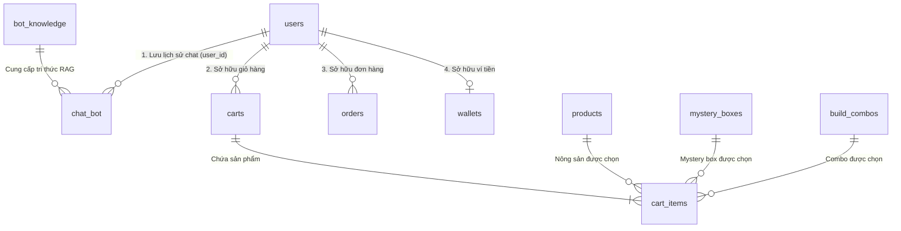
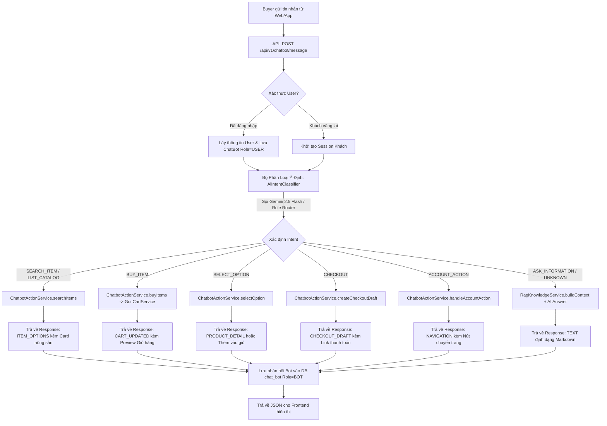
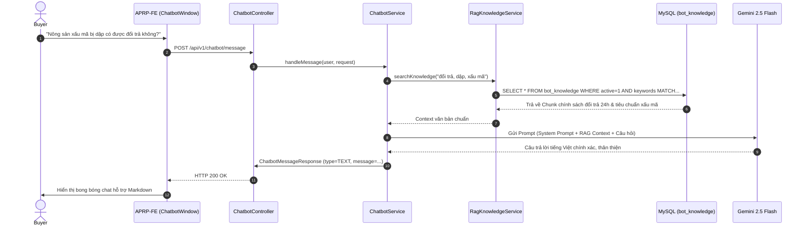
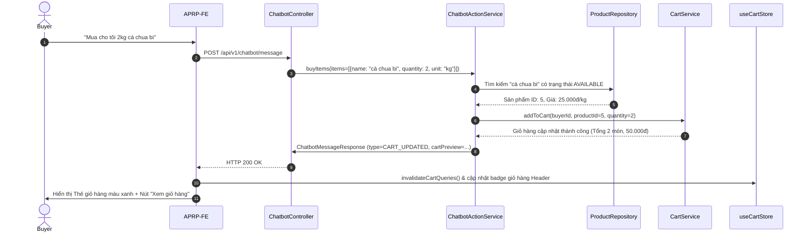

# TÀI LIỆU KIẾN TRÚC & QUY TRÌNH NGHIỆP VỤ: AI CHATBOT CO-PILOT
## Phân Hệ Trợ Lý ẢO Nông Sản & Đi Chợ Thông Minh CapNong (Feature F07)

> **Mã tài liệu:** `CAPNONG-DOC-F07-AI-CHATBOT`  
> **Dành cho:** Frontend Devs, Backend Peers, QA/Tester, Tech Lead & Hội đồng Đánh giá Khóa luận Tốt nghiệp (Capstone Defense).  
> **Nhánh phát triển:** `feature/AI-chatbot-copilot`  
> **Trạng thái:** Thiết kế kiến trúc & Đã sẵn sàng triển khai mã nguồn.  

---

## 1. Bối Cảnh Thực Tế & Động Lực Nghiệp Vụ (Business Background)

Trong mô hình thương mại điện tử nông sản **CapNong** (kết nối trực tiếp nhà vườn và người tiêu dùng đô thị, tiên phong thương mại hóa **Nông sản xấu mã - Ugly Produce**), khách hàng mua sắm (**Buyer**) thường gặp phải 4 rào cản tâm lý và thao tác:

1. **Hiểu lầm về "Nông sản xấu mã":** Khách hàng mới chưa hiểu rõ vì sao rau củ quả méo mó, sần sùi lại có giá rẻ hơn 20%–40% nhưng vẫn an toàn và đạt chuẩn VietGAP/Organic.
2. **Khó tìm kiếm và chọn lựa:** Danh mục nông sản tươi biến động theo mùa vụ, nhiều tên gọi địa phương (rau muống nước, rau muống cạn, cải thìa, cải ngọt, xoài cát Hòa Lộc, xoài keo...) khiến việc gõ ô tìm kiếm truyền thống không bao quát hết nhu cầu.
3. **Thao tác giỏ hàng tốn công đoạn:** Khách có nhu cầu mua nhiều món cho một mâm cơm (ví dụ: "lấy cho tôi 2kg cà chua, 1 bó rau muống, 500g gừng") phải bấm từng sản phẩm, chọn phân loại, nhập số lượng nhiều lần.
4. **Cần giải đáp chính sách tức thì:** Thắc mắc về quy cách đóng gói thùng giữ lạnh, thời gian giao hàng 2-4h hỏa tốc, hay chính sách bảo hành 1 đổi 1 trong 24h đối với rau củ dập nát.

Phân hệ **AI Chatbot Co-pilot (Feature F07)** ra đời như một **"Nhân viên tư vấn kiêm Phụ tá đi chợ"** túc trực 24/7 ngay góc màn hình, mang lại trải nghiệm thương mại đàm thoại (**Conversational Commerce**):
- **Tư vấn tự nhiên & chính xác:** Sử dụng mô hình ngôn ngữ lớn (Google Gemini 2.5 Flash) kết hợp kho tri thức nền tảng (RAG Knowledge Base) để trả lời chính sách, mẹo bảo quản thực phẩm.
- **Tương tác trực quan qua thẻ (Rich UI Cards):** Không chỉ trả lời văn bản thô, AI trả về trực tiếp thẻ nông sản, thẻ combo, thẻ xem trước giỏ hàng có thể tương tác (bấm chọn, bấm mua).
- **Hành động xuyên suốt (Agentic Actions):** Khách chỉ cần ra lệnh bằng ngôn ngữ tự nhiên ("Mua 2kg cà chua"), AI tự động tính toán số lượng và đưa thẳng vào giỏ hàng thật của khách.

---

## 2. Tiêu Chuẩn Thiết Kế & So Sánh Kiến Trúc (Architecture Evolution)

### So sánh Kiến trúc Dự án Cũ vs Dự án Mới (APRP):

```
┌─────────────────────────────────────────────────────────────────────────────────────────────────┐
│ DỰ ÁN CŨ (BE_CapNong_Exe2 / FE_Capnong_exe2):                                                   │
│   • Bị chia rẽ 2 controller: `/chatbot/chat` (chỉ trả lời text) và `/ai/chat` (agent mua hàng). │
│   • DTO phản hồi bị phân mảnh (`ChatResponse` vs `AiChatResponse`), FE phải giữ type @deprecated.│
│   • Lưu session chọn hàng tạm bợ bằng `ConcurrentHashMap` trong RAM máy chủ.                    │
│   • Frontend chia nhỏ hơn 20 file rải rác, styling pha trộn inline styles và CSS modules cũ.    │
├─────────────────────────────────────────────────────────────────────────────────────────────────┤
│ DỰ ÁN MỚI (APRP-BE / APRP-FE - CLEAN ARCHITECTURE):                                             │
│   • Hợp nhất 1 luồng duy nhất: `/api/v1/chatbot/message` đa năng (Text + Rich UI Cards).        │
│   • DTO phản hồi đồng nhất: `ChatbotMessageResponse` phân loại `AiResponseType` rõ ràng.         │
│   • Client State chuẩn hóa: TanStack React Query v5 + Zustand v5 store.                         │
│   • UI tái thiết kế 100%: Tailwind CSS v4, Lucide React, Material 3, Responsive Mobile/Desktop. │
│   • AI Client chuyên biệt: Kế thừa chuẩn `GeminiMealPlanAiClient`, có fallback deterministic.    │
└─────────────────────────────────────────────────────────────────────────────────────────────────┘
```

---

## 3. Liên Kết CSDL & Mô Hình Thực Thể (Database ERD)

Phân hệ Chatbot Co-pilot kết nối trực tiếp với 8 thực thể trọng yếu trong CSDL MySQL `DB_CapNong`:



### Ý nghĩa các bảng dữ liệu cốt lõi:
1. `chat_bot`: Lưu trữ vết hội thoại giữa User và Bot (`id`, `user_id`, `role`: `'USER'` | `'BOT'`, `content`, `created_at`).
2. `bot_knowledge`: Kho tri thức quy định và cẩm nang sàn CapNong (`id`, `type`: `'POLICY'` | `'FAQ'`, `title`, `content`, `keywords`, `active`, `created_at`, `updated_at`).
3. `products`, `mystery_boxes`, `build_combos`: Nguồn nông sản thực tế đang bán trên sàn để AI tra cứu thời gian thực.
4. `carts`, `cart_items`: Nơi AI tự động thêm nông sản vào giỏ hàng khi người dùng phát lệnh mua.
5. `orders`, `wallets`: Nguồn dữ liệu tra cứu khi người dùng hỏi về tình trạng giao hàng hoặc số dư ví.

---

## 4. Kiến Trúc Luồng Xử Lý Ý Định (Agent Intent Router & Lifecycle)



---

## 5. Quy Trình Tuần Tự Cho Từng Kịch Bản (Sequence Diagrams)

### 5.1. Kịch bản: Hỏi chính sách hoặc mẹo vặt (RAG Knowledge Flow)



### 5.2. Kịch bản: Đi chợ rảnh tay ("Mua 2kg cà chua bi")



---

## 6. Đặc Tả Giao Diện API (API Specifications)

### 6.1. Gửi tin nhắn tới Chatbot
- **Endpoint:** `POST /api/v1/chatbot/message`
- **Quyền truy cập:** Public (Hỗ trợ cả Buyer đã đăng nhập lẫn khách chưa đăng nhập).
- **Request Body:**
```json
{
  "message": "Shop có bán xoài keo không?",
  "sessionId": "sess_1792948123_abc123"
}
```

- **Response Type 1: ITEM_OPTIONS (Tìm thấy nông sản)**
```json
{
  "code": 1000,
  "message": "Thành công",
  "result": {
    "type": "ITEM_OPTIONS",
    "message": "Mình tìm thấy các loại xoài tươi ngon đang có tại nhà vườn:",
    "itemOptions": [
      {
        "itemType": "PRODUCT",
        "itemId": 12,
        "name": "Xoài Keo Xuất Khẩu (Xấu Mã)",
        "imageUrl": "https://res.cloudinary.com/.../xoai-keo.jpg",
        "price": 28000,
        "unit": "kg",
        "availableQuantity": 45,
        "description": "Vỏ rám nhẹ tự nhiên, thịt giòn ngọt, chấm muối ớt cực ngon."
      }
    ],
    "timestamp": "2026-10-26T05:20:00"
  }
}
```

- **Response Type 2: CART_UPDATED (Tự động thêm vào giỏ hàng)**
```json
{
  "code": 1000,
  "message": "Thành công",
  "result": {
    "type": "CART_UPDATED",
    "message": "Đã thêm thành công **2 kg Cà chua bi** vào giỏ hàng của bạn!",
    "cart": {
      "items": [
        {
          "itemType": "PRODUCT",
          "itemId": 5,
          "name": "Cà chua bi Đà Lạt",
          "imageUrl": "https://res.cloudinary.com/.../ca-chua.jpg",
          "quantity": 2,
          "unit": "kg",
          "unitPrice": 25000,
          "totalPrice": 50000
        }
      ],
      "totalAmount": 50000
    },
    "timestamp": "2026-10-26T05:21:00"
  }
}
```

- **Response Type 3: NAVIGATION (Hỗ trợ tài khoản/đơn hàng)**
```json
{
  "code": 1000,
  "message": "Thành công",
  "result": {
    "type": "NAVIGATION",
    "message": "Bạn có 2 đơn hàng đang được shipper giao trong hôm nay. Bấm nút bên dưới để theo dõi lộ trình đơn hàng:",
    "navigation": {
      "url": "/orders",
      "label": "Xem danh sách đơn hàng"
    },
    "timestamp": "2026-10-26T05:22:00"
  }
}
```

### 6.2. Lịch sử hội thoại
- **`GET /api/v1/chatbot/history`**: Lấy toàn bộ lịch sử đoạn chat của User đang đăng nhập (`role`: `'USER'` | `'BOT'`).
- **`DELETE /api/v1/chatbot/history`**: Xóa sạch lịch sử chat của User để bắt đầu phiên mới.

### 6.3. Quản trị tri thức (Admin CMS)
- **`GET /api/v1/admin/bot-knowledge`**: Danh sách tất cả tài liệu tri thức RAG.
- **`POST /api/v1/admin/bot-knowledge`**: Tạo mới tri thức (`type`, `title`, `content`, `keywords`, `active`).
- **`PUT /api/v1/admin/bot-knowledge/{id}`**: Cập nhật tri thức.
- **`DELETE /api/v1/admin/bot-knowledge/{id}`**: Xóa tri thức.

---

## 7. Xử Lý Các Trường Hợp Ngoại Lệ & An Toàn (Edge Cases & Safety)

1. **Khi Gemini API hết Quota / Mất mạng quốc tế:**
   - Hệ thống tự động kích hoạt bộ xử lý Fallback cục bộ (Deterministic Keyword Matcher). Chatbot vẫn trả lời được 100% các câu hỏi về chính sách trong `bot_knowledge` và tìm kiếm sản phẩm cơ bản mà không báo lỗi sập ứng dụng.
2. **Khách chưa đăng nhập ra lệnh xem Đơn hàng / Ví tiền:**
   - Hệ thống không báo lỗi 500. Chatbot trả lời nhã nhặn: *"Bạn cần đăng nhập tài khoản để xem thông tin đơn hàng và ví tiền của mình nhé!"* kèm nút bấm điều hướng sang trang `/login`.
3. **Sản phẩm khách yêu cầu mua đã hết hàng:**
   - Hệ thống kiểm tra số lượng tồn kho khả dụng (`availableQuantity <= 0`). Bot thông báo: *"Món [Tên món] hiện vừa hết hàng tại nhà vườn, bạn tham khảo các nông sản cùng loại sau nhé:"* kèm các thẻ gợi ý thay thế.
4. **Bảo mật thông tin tài khoản nhạy cảm:**
   - Bot tuyệt đối không hiển thị mật khẩu, mã OTP, số thẻ ngân hàng đầy đủ trong khung chat (che số `**** 1234`).

---

## 8. Danh Mục 12 Kịch Bản Nâng Cao Cải Tiến Trải Nghiệm Khách Hàng (12 Enhanced Use Cases)

| Nhóm | Mã Kịch Bản | Ý Định Người Dùng | DTO & Thẻ Tương Tác Phản Hồi |
| :--- | :--- | :--- | :--- |
| **I. Sau Mua Hàng** | `TRACK_ORDER` (Case 1.1) | "Đơn hàng của tôi tới đâu rồi?", "Shipper tới chưa?" | `OrderTrackingCard`: Trạng thái đơn, SĐT tài xế, tiến độ, nút mở bản đồ tracking GPS. |
| | `RETURN_REQUEST` (Case 1.2) | "Cà chua nhận về bị dập hết rồi, đổi trả sao?", "Hoàn tiền 24h" | `ReturnGuidanceCard`: Cam kết bồi thường 100% trong 24h, nút gửi ảnh khiếu nại. |
| | `CANCEL_ORDER` (Case 1.3) | "Hủy đơn giúp tôi", "Đặt nhầm địa chỉ" | `OrderCancelCard`: Kiểm tra điều kiện hủy (PENDING/PROCESSING), thông báo tiền hoàn vào ví. |
| **II. Tư Vấn Đi Chợ** | `BUDGET_COMBO` (Case 2.1) | "Tôi có 100k, chọn giúp tôi rau củ gia đình 4 người" | `BudgetComboCard`: Cân đối mâm cơm $\le$ 100k, nút 1-click **"Thêm toàn bộ combo vào giỏ"**. |
| | `RECIPE_SUGGESTION` (Case 2.2) | "Có bắp cải và cà rốt nấu món gì ngon?" | `RecipeCard`: Công thức món canh/xào + gợi ý mua thêm nấm/rau thơm có sẵn trên sàn. |
| | `MYSTERY_BOX_QA` (Case 2.3) | "Hộp bí ẩn hôm nay có gì?", "Tôi bị dị ứng nấm mua được không?" | `MysteryBoxQaCard`: Giới thiệu nông sản trong ngày + **Cảnh báo dị ứng cá nhân hóa** từ hồ sơ y tế. |
| **III. Khuyến Mãi & Phí Ship** | `VOUCHER_SUGGESTION` (Case 3.1) | "Hôm nay có voucher freeship nào không?" | `VoucherListCard`: Vé giảm giá khả dụng, hạn dùng, đơn tối thiểu, nút **"Sao chép mã"**. |
| | `SHIPPING_TIPS` (Case 3.2) | "Sao tiền ship đắt thế?", "Làm sao giảm phí giao hàng?" | `ShippingTipsCard`: Phân tích giỏ hàng đa shop, mẹo gom cùng 1 nhà vườn để tối ưu phí vận chuyển và tiết kiệm chi phí hơn. |
| **IV. Giáo Dục & Niềm Tin** | `SAFETY_STANDARDS` (Case 4.1) | "Nông sản xấu mã có phun thuốc không?", "Chuẩn VietGAP là gì?" | `SAFETY_STANDARDS`: Giải thích tiêu chuẩn VietGAP/Organic, ngoại quan cong queo nhưng 100% tươi mới. |
| | `PRESERVATION_TIPS` (Case 4.2) | "Mẹo giữ rau tươi lâu trong tủ lạnh", "Cà chua bảo quản sao?" | `PreservationTipsCard`: 4 thẻ cẩm nang trực quan (Rau lá, Củ quả, Cà chua/trái cây, Nấm tươi). |
| **V. Hỗ Trợ Đa Kênh** | `HUMAN_HANDOVER` (Case 5.1) | "Gặp nhân viên tư vấn", "Chat với người thật", "Hotline" | `HumanHandoverCard`: Hotline `1900-CAPNONG`, Zalo OA, nút **"Mở chat P2P với Nhà Vườn"**. |
| | `ROLE_GUIDANCE` (Case 5.2) | "Tôi là nhà vườn muốn mở shop", "Tài xế rút tiền COD sao?" | `RoleGuidanceCard`: Nhận diện vai trò người dùng (Shop / Shipper / Guest) để điều hướng đúng cổng portal. |
| **VI. Mua Sắm Thông Minh** | `REORDER_RECENT` (Case 6.1) | "Đặt lại đơn gần nhất", "Mua lại đơn #100" | `ReorderCard`: Kiểm tra tồn kho từng món (còn/hết hàng), hỗ trợ đặt lại đơn gần nhất hoặc chỉ định mã đơn bất kỳ, có bước xác nhận trước khi thêm vào giỏ. |
| | `FLASH_RESCUE` (Case 6.2) | "Hôm nay có giải cứu nông sản gì không?", "Flash sale 24h" | `FlashRescueCard`: Danh mục nông sản cận vụ giảm 30%-50%, đồng hồ đếm ngược giờ kết thúc, nút gom đơn. |
| **VII. Cá Nhân Hóa & Sức Khỏe** | `MEAL_PLAN_BRIDGE` (Case 7.1) | "Tôi bị tiểu đường / dạ dày nên ăn rau gì?", "Gợi ý thực đơn eat clean" | `MealPlanBridgeCard`: Tư vấn dinh dưỡng, gợi ý mâm cơm theo bệnh lý + Nút cầu nối sang **AI Meal Planner**. |
| | `SEASONAL_CALENDAR` (Case 7.2) | "Mùa này có trái cây / rau gì ngon?", "Lịch mùa vụ nông sản" | `SeasonalCalendarCard`: Lịch nông sản theo tháng tại Việt Nam (thu hoạch rộ, rẻ nhất, ngọt nhất). |
| **VIII. Dấu Chân Xanh** | `GREEN_IMPACT` (Case 8.1) | "Tôi đã cứu được bao nhiêu kg rau?", "Dấu chân xanh của tôi" | `GreenImpactCard`: Tổng kg nông sản giải cứu, lượng CO₂ giảm thải, số cây xanh bảo vệ, nút chia sẻ. |
| **IX. Thanh Toán & Tài Chính** | `PAYMENT_ASSISTANCE` (Case 9.1) | "Tôi bị trừ tiền PayOS nhưng đơn chưa duyệt", "Số tài khoản chuyển khoản" | `PaymentAssistanceCard`: Thông tin STK công ty, trạng thái đối soát giao dịch treo, hotline CSKH khẩn cấp. |
| | `WALLET_INFO` (Case 9.2) | "Ví của tôi có bao nhiêu tiền?", "Điểm tích lũy đổi quà sao?" | `WalletInfoCard`: Đọc an toàn điểm CapNong Xu, tài khoản ngân hàng liên kết, link an toàn sang `/profile?tab=wallet`. |
| **X. Xử Lý Sự Cố Hậu Mãi** | `UPDATE_SHIPPING_INFO` (Case 10.1) | "Tôi lỡ nhập sai địa chỉ giao hàng", "Đổi SĐT người nhận" | `UpdateShippingInfoCard`: Kiểm tra trạng thái đơn hàng (chưa xuất kho thì cho phép đổi, đã giao thì hỗ trợ hotline). |

---

## 9. Chi Tiết Nâng Cấp Kỹ Thuật & Tối Ưu Trải Nghiệm Thực Tế (Production Hardening & Changelog)

Nhằm đảm bảo hệ thống vận hành bền bỉ trong môi trường thực tế và đem lại trải nghiệm mượt mà cho khách hàng, phân hệ Chatbot Co-pilot đã được nâng cấp toàn diện các cơ chế sau:

### 9.1. Nâng cấp Tương tác Voucher Thông minh (Case 3.1 - Voucher Interactive UX)
- **Lọc chính xác theo ngữ cảnh:** Khi khách hỏi *"có mã freeship nào không"*, hệ thống chỉ lọc đúng voucher miễn phí vận chuyển; khi hỏi *"voucher của shop A"*, hệ thống chỉ lấy voucher của shop cụ thể.
- **Nút "Lưu mã" trực tiếp:** Thẻ `VoucherListCard` tích hợp nút tương tác nhận mã 1-click lưu thẳng vào ví voucher của tài khoản (`user_vouchers`). 
- **Phân định trạng thái rõ ràng:** Voucher chưa lưu hiển thị nút **"Lưu mã"** nổi bật; voucher đã nhận hiển thị trạng thái **"Đã lưu / Sẵn sàng dùng"** giúp người mua không bị thao tác trùng lặp.

### 9.2. Chuẩn hóa Tìm kiếm Nông sản & Khử nhiễu Từ khóa (`cleanSearchKeyword`)
- **Loại bỏ cơ chế cắt từ khóa thô sơ:** Xóa bỏ hoàn toàn logic `broadQuery` cũ (trước đây tự cắt sau dấu cách đầu tiên khiến câu hỏi *"dưa leo"* bị cắt thành *"dưa"* rồi tìm nhầm sang *"dưa hấu"*).
- **Thuật toán làm sạch từ đệm tự nhiên:** Hàm `cleanSearchKeyword` bóc tách sạch sẽ các tiền tố / hậu tố giao tiếp thông dụng (ví dụ: *"shop có bán ... không"*, *"tôi muốn mua ... nhé"*, *"cho mình hỏi ..."*) để giữ lại đúng tên nông sản chuẩn xác.
- **Xử lý khi nông sản chưa có sẵn (Zero-Result Graceful Fallback):** Khi sàn chưa có loại nông sản khách yêu cầu, bot phản hồi trung thực: *"Hiện tại sàn CapNong chưa có sẵn nông sản '[Tên nông sản]', bạn có thể tham khảo một số mặt hàng tươi ngon khác đang có sẵn nhé:"* kèm danh sách sản phẩm thật đang có trong kho CSDL (loại bỏ hoàn toàn mock data giả lập).

### 9.3. Tương tác Chọn Mua Combo Trực tiếp (`BUILD_COMBO`) & Sửa UI Card
- **Hỗ trợ thêm Combo vào giỏ hàng từ Chatbot:** Bổ sung nhánh xử lý `BUILD_COMBO` trong `ChatbotActionServiceImpl.selectItemOption`, cho phép khách bấm nút `+ Chọn` trên thẻ Combo để thêm thẳng vào giỏ hàng thật (`cartService.addComboToCart`).
- **Khắc phục lỗi cắt chữ trên Card:** Nâng cấp class CSS từ `truncate` đơn dòng sang `line-clamp-2` trong `ItemOptionsCard.tsx`, giúp tên combo và mô tả nông sản hiển thị đầy đủ, không còn bị cắt cụt lủn chữ (`Combo R...`).

### 9.4. Đồng bộ Giỏ hàng Thời gian thực (Real-time Cart Invalidation)
- Khi chatbot hoàn tất hành động thêm vào giỏ hàng (`CART_UPDATED`), cả store `useChatbotStore.ts` và component `CartUpdatedCard.tsx` tự động gọi lệnh `queryClient.invalidateQueries({ queryKey: cartKeys.all })`.
- Badge số lượng giỏ hàng trên Header và trang Cart lập tức cập nhật số lượng mới mà người dùng không cần phải tải lại trang.

### 9.5. Mở rộng Nhận diện Ý định Thanh toán (`CHECKOUT`)
- Bổ sung bộ nhận diện ngôn ngữ tự nhiên phong phú cho ý định đặt hàng: *"Đặt hàng giỏ này"*, *"Tiến hành đặt hàng"*, *"Lên đơn giỏ hàng"*, *"Mua giỏ này"*, *"Thanh toán giỏ hàng"* $\rightarrow$ Kích hoạt ngay luồng tạo đơn nháp / điều hướng trang Checkout.

### 9.6. Chuẩn hóa Mô hình AI & Quản trị Pool API Key (`gemini-2.5-flash`)
- **Mô hình AI chính thức:** Sử dụng duy nhất mô hình **`gemini-2.5-flash`** (mô hình ổn định và tối ưu nhất của Google AI Studio trên endpoint API `v1beta`). Đã loại bỏ hoàn toàn các mô hình cũ `gemini-1.5-flash` và `gemini-2.0-flash` do Google đã ngừng hỗ trợ (trả mã `HTTP 404`).
- **Bộ lọc khóa tự động (`addIfValidKey`):** Tự động nhận diện và loại bỏ các token dạng `AQ.Ab8RN6...` (OAuth2 Access Token của Google Cloud gây lỗi `HTTP 401 ACCESS_TOKEN_TYPE_UNSUPPORTED`) và các key không đủ độ dài chuẩn (`HTTP 400 API_KEY_INVALID`). Chỉ đưa vào pool các API Key hợp lệ từ Google AI Studio (bắt đầu bằng `AIzaSy...`).
- **Cơ chế xoay vòng tự động (Key Rotation):** Quét qua danh sách `GEMINI_API_KEY` và `GEMINI_KEY_1` $\rightarrow$ `GEMINI_KEY_50` để xoay vòng khi gặp giới hạn hạn ngạch.

### 9.8. Phân Hệ Trợ Lý Đa Vai Trò & Điều Hướng Trực Tiếp (Case 5.2 - Role Guidance & Portal Co-pilot)
Phân hệ Chatbot Co-pilot được mở rộng phạm vi hoạt động ra toàn bộ 3 vai trò người dùng trong hệ sinh thái sàn CapNong: **Khách mua (Buyer)**, **Nhà vườn (Shop/Farmer)** và **Tài xế giao hàng (Shipper)**.

#### 1. Cơ Chế Nhúng Widget Toàn Cục (Global Layout Mounting):
- Di chuyển `<ChatbotFloatingWidget />` vào `RootLayout.tsx` để chatbot hiện diện xuyên suốt trên mọi trang (`/`, `/shop`, `/shipper`, `/admin`).
- Tự động đóng/thu gọn popup chat khi người dùng nhấn nút điều hướng CTA thông qua Zustand action `toggleOpen()`.

#### 2. Đồng Bộ Hóa URL Query Params & Tự Động Kích Hoạt Modal:
Cả hai giao diện quản trị `FarmerPortal.tsx` và `Dashboard.tsx` (Shipper) được tích hợp `useSearchParams`:
- **Đồng bộ Tab URL:** `?tab=blogs`, `?tab=vouchers`, `?tab=products`, `?tab=orders`, `?tab=wallet`, `?tab=disputes`, `?tab=messages`, `?tab=reviews`, `?tab=profile`.
- **Đồng bộ Hành động Modal (Action Query):**
  - `?tab=products&action=add`: Tự động mở Modal Đăng bán nông sản mới (`setShowAddProductModal(true)`).
  - `?tab=products&action=blindbox`: Tự động kích hoạt Công cụ tạo Túi mù giải cứu (`setShowBlindBoxTool(true)`).
  - `?tab=products&action=combo`: Tự động mở Trình ghép Combo bữa ăn (`setShowComboBuilder(true)`).
  - `?tab=wallet&action=withdraw`: Tự động hiển thị Biểu mẫu yêu cầu rút tiền về ngân hàng (`setShowWithdrawModal(true)`).
  - `?tab=profile` (Shipper): Điều hướng mở Hồ sơ cá nhân và bảng đối soát tiền mặt COD.

#### 3. Bảng Ánh Xạ Phân Nhánh Nghiệp Vụ Theo Câu Hỏi Thực Tế:

| Vai Trò | Phân Hệ / Chức Năng | Từ Khóa Nhận Diện Tiêu Biểu | Tiêu Đề Thẻ & Hướng Dẫn | Đường Dẫn Điều Hướng (Deep Link) |
| :--- | :--- | :--- | :--- | :--- |
| **Shop** | **Tin tức / Blog / Bài viết** | "viết bài", "đăng tin tức", "bài viết nông sản", "blog", "câu chuyện vườn" | `Hướng Dẫn Đăng Tin Tức & Góc Nhà Vườn`<br>3 bước: Vào tab Blog $\rightarrow$ Viết bài $\rightarrow$ Xuất bản ảnh quy trình sạch. | `/shop?tab=blogs` |
| **Shop** | **Voucher / Mã giảm giá** | "tạo voucher", "mã giảm giá shop", "phát hành voucher", "khuyến mãi shop" | `Hướng Dẫn Tạo & Phát Hành Voucher Cho Shop`<br>3 bước: Mở tab Voucher $\rightarrow$ Tạo mã mới $\rightarrow$ Kích hoạt ưu đãi. | `/shop?tab=vouchers` |
| **Shop** | **Đăng bán nông sản mới** | "đăng bán", "thêm sản phẩm", "thêm nông sản", "bán rau", "đăng củ quả" | `Hướng Dẫn Đăng Bán Nông Sản Mới`<br>3 bước: Mở tab Sản phẩm $\rightarrow$ Bấm Thêm sản phẩm $\rightarrow$ Điền VietGAP/giá bán. | `/shop?tab=products&action=add` |
| **Shop** | **Túi mù giải cứu (Blind Box)** | "túi mù", "hộp bí ẩn", "blind box", "tạo túi mù", "túi mù giải cứu" | `Công Cụ Tạo Túi Mù Nông Sản Giải Cứu`<br>Gom rau củ xấu mã/cận date bán giá ưu đãi giải cứu nhanh chóng. | `/shop?tab=products&action=blindbox` |
| **Shop** | **Ghép Combo bữa ăn** | "ghép combo", "tạo combo", "bán combo", "set rau gia đình" | `Công Cụ Ghép Combo Nông Sản Bữa Ăn`<br>Phối 3-5 loại nông sản (canh chua, xào, lẩu) giá ưu đãi kích cầu. | `/shop?tab=products&action=combo` |
| **Shop** | **Danh sách & Tồn kho** | "danh sách sản phẩm", "tồn kho", "quản lý sản phẩm", "sửa giá", "hết hàng" | `Quản Lý Danh Sách & Tồn Kho Nông Sản`<br>Bật/tắt kinh doanh, sửa giá thu hoạch và theo dõi số lượng tồn. | `/shop?tab=products` |
| **Shop** | **Xử lý đơn hàng nhà vườn** | "xử lý đơn", "chuẩn bị hàng", "đóng gói", "giao shipper", "đơn hàng shop" | `Quản Lý & Chuẩn Bị Đơn Hàng Nhà Vườn`<br>Đóng thùng giữ lạnh và bấm xác nhận bàn giao cho Shipper. | `/shop?tab=orders` |
| **Shop** | **Ví doanh thu & Rút tiền** | "rút tiền doanh thu", "ví shop", "ví nhà vườn", "tiền bán hàng", "rút tiền" | `Ví Doanh Thu & Rút Tiền Về Ngân Hàng`<br>Kiểm tra số dư thực nhận và gửi lệnh rút tiền về tài khoản ngân hàng. | `/shop?tab=wallet&action=withdraw` |
| **Shop** | **Khiếu nại & Đổi trả** | "khiếu nại shop", "tranh chấp shop", "hàng dập", "khách đòi hoàn tiền" | `Xử Lý Khiếu Nại & Yêu Cầu Hoàn Tiền`<br>Kiểm tra ảnh/video bằng chứng dập nát và phản hồi bồi thường. | `/shop?tab=disputes` |
| **Shop** | **Chat trực tiếp với khách** | "chat với khách", "tin nhắn khách", "hộp thư shop", "liên hệ người mua" | `Hộp Thư Trực Tiếp Với Khách Hàng`<br>Tư vấn độ tươi, độ chín của hoa quả và giải đáp đơn hàng 1:1. | `/shop?tab=messages` |
| **Shop** | **Đánh giá & Phản hồi** | "đánh giá shop", "review shop", "số sao", "khách nhận xét" | `Đánh Giá & Nhận Xét Từ Khách Hàng`<br>Theo dõi số sao và trả lời bình luận để nâng cao uy tín thương hiệu. | `/shop?tab=reviews` |
| **Shop** | **Hồ sơ vườn & Tọa độ lấy hàng** | "địa chỉ vườn", "tọa độ", "vị trí lấy hàng", "gps vườn", "hồ sơ shop" | `Cài Đặt Hồ Sơ Nhà Vườn & Vị Trí Lấy Hàng`<br>Cập nhật định vị GPS chính xác trên bản đồ để Shipper đến lấy nông sản. | `/shop?tab=profile` |
| **Shipper** | **Bật trực tuyến & Nhận đơn** | "bật trực tuyến", "nhận đơn", "đơn mới", "nhận chuyến", "bật online", "tìm chuyến" | `Bật Trực Tuyến & Nhận Đơn Hàng Mới`<br>Gạt nút Trực tuyến và nhận các chuyến giao hàng quanh bán kính vị trí. | `/shipper?tab=new` |
| **Shipper** | **Giao hàng & Xác nhận lấy hàng** | "đơn đang giao", "xác nhận lấy hàng", "giao thành công", "chụp ảnh giao" | `Quy Trình Giao Hàng & Xác Nhận 2 Chặng`<br>Xác nhận nhận thùng tại vườn $\rightarrow$ giao tận tay $\rightarrow$ thu tiền mặt COD. | `/shipper?tab=delivering` |
| **Shipper** | **Bản đồ chỉ đường live** | "bản đồ tài xế", "lộ trình giao", "chỉ đường shipper", "map shipper" | `Bản Đồ Lộ Trình Giao Hàng Trực Tiếp`<br>Lộ trình dẫn đường tối ưu tránh kẹt xe và đo khoảng cách giao nhận. | `/shipper?tab=delivering` |
| **Shipper** | **Tiền COD & Ví ký quỹ** | "tiền cod", "rút cod", "rút tiền cod", "ký quỹ", "ứng tiền", "nộp cod" | `Quản Lý Tiền Thu COD & Ví Ký Quỹ Tài Xế`<br>Đối soát tiền mặt COD đã thu trong ngày và rút hoa hồng giao nhận. | `/shipper?tab=profile` |
| **Shipper** | **Hồ sơ tài xế & Biển số xe** | "hồ sơ tài xế", "biển số xe", "thông tin tài xế", "bằng lái xe" | `Hồ Sơ Cá Nhân & Phương Tiện Giao Hàng`<br>Quản lý thông tin phương tiện, GPLX và lịch sử chuyến xe hoàn thành. | `/shipper?tab=profile` |
| **Khách/Guest** | **Đăng ký mở shop nhà vườn** | "Tôi là nhà vườn muốn đăng ký bán", "mở shop", "bán rau trên sàn" | `Đăng Ký Mở Gian Hàng Nhà Vườn CapNong`<br>Đăng ký tài khoản Shop $\rightarrow$ Điền GPS vườn $\rightarrow$ Đăng bán nông sản. | `/dang-ky?role=shop` |
| **Khách/Guest** | **Đăng ký làm tài xế** | "Đăng ký làm tài xế", "muốn làm shipper", "tuyển tài xế" | `Đăng Ký Trở Thành Tài Xế Giao Hàng CapNong`<br>Đăng ký tài khoản Shipper $\rightarrow$ Cập nhật xe & GPLX $\rightarrow$ Bật app nhận chuyến. | `/dang-ky?role=shipper` |
| **Khách/Guest** | **Hỏi tài xế rút COD ở đâu** | "Tài xế rút tiền COD ở đâu?", "rút tiền cod tài xế" | `Hướng Dẫn Rút Tiền COD & Ví Ký Quỹ Cho Tài Xế`<br>Vào mục Hồ sơ & Tài chính trên Cổng Shipper $\rightarrow$ Đối soát sao kê COD. | `/shipper?tab=profile` |
### 9.9. Cơ Chế Đặt Lại Đơn Hàng & Kiểm Soát Tồn Kho Thời Gian Thực (Case 6.1 - Reorder & Stock Availability Guard)
Nhằm khắc phục tình trạng AI đoán mò bốc nhầm đơn khi khách hỏi thời gian chung chung và tránh tự động thêm hàng vào giỏ khi chưa qua bước xác nhận của người mua, phân hệ Đặt lại đơn hàng được chuẩn hóa theo các quy chuẩn:

#### 1. Phân Tách Ý Định Rõ Ràng (Deterministic Intent Separation):
- **Đơn gần nhất / Đơn có ID cụ thể (`REORDER_RECENT`):**
  - Kích hoạt khi khách gõ *"Đặt lại đơn gần nhất"*, *"Mua lại đơn vừa đặt"*, hoặc ghi rõ mã đơn *"Đặt lại đơn 100"*, *"Đơn #105"*.
  - Bot trích xuất ID đơn (kể cả các đơn cũ đã đặt từ lâu). Nếu không có ID, bot bốc đơn `createdAt DESC` mới nhất của đúng Buyer đó.
  - Kiểm tra quyền sở hữu: Tuyệt đối không cho phép đặt lại đơn của tài khoản khác (bảo mật dữ liệu cá nhân).
- **Khoảng thời gian không xác định (`VIEW_ORDERS`):**
  - Khi khách hỏi *"Mua lại đơn tuần trước"*, *"Đơn tháng trước"*, *"Đơn cũ"*, bot **từ chối đoán mò**.
  - Phản hồi giải thích: Do trong khoảng thời gian đó khách có thể có nhiều đơn hàng khác nhau, bot không thể tự ý chọn 1 đơn. Bot cung cấp nút điều hướng **"Xem Lịch Sử Đơn Hàng"** sang `/orders` để khách tự chọn đơn mong muốn.

#### 2. Kiểm Tra Tồn Kho 3 Cấp Độ (Live Stock & Availability Verification):
Duyệt qua từng `OrderDetail` (bao gồm `Product`, `MysteryBox`, `BuildCombo`):
- **Kịch bản A (Còn đủ 100% món):** Liệt kê đủ tất cả sản phẩm, badge xanh `Còn hàng`, nút xác nhận: *"Xác nhận thêm cả X món vào giỏ"*.
- **Kịch bản B (Còn một phần món - Partial Availability):** 
  - Liệt kê rõ: Món còn hàng hiển thị giá và nút `+ Thêm`; Món hết hàng hiển thị badge đỏ `Hết hàng / Tạm hết mùa` (disabled).
  - Nút xác nhận tự động đổi thành: *"Xác nhận thêm [Y] món còn hàng vào giỏ"*.
- **Kịch bản C (Hết sạch 100% món):** 
  - Thông báo toàn bộ nông sản trong đơn cũ này hiện đã hết hàng hoặc hết mùa vụ.
  - Vô hiệu hóa nút thêm giỏ, hiển thị nút điều hướng: *"Khám phá nông sản tươi khác trên sàn"* $\rightarrow$ `/san-pham`.

#### 3. Phòng Ngừa Ngoại Lệ (Exception Guards):
- **Khách vãng lai chưa đăng nhập:** Nhắc nhở đăng nhập lịch sự + nút điều hướng `/dang-nhap`.
- **Khách chưa từng có đơn hàng nào:** Thông báo chưa có lịch sử đơn + nút khám phá catalog `/san-pham`.
- **Mã đơn không tồn tại hoặc không thuộc User:** Thông báo bảo vệ quyền riêng tư + nút mở Lịch sử đơn hàng `/orders`.
- **Đơn cũ đang trong trạng thái giao (PENDING / SHIPPING):** Thêm cảnh báo vàng: *"⚠️ Lưu ý: Đơn hàng #... của bạn hiện đang được chuẩn bị/giao hàng"* trước khi khách xác nhận đặt thêm đơn mới.
- **Biến động giá:** Hiển thị giá thu hoạch hiện tại của từng nông sản để đảm bảo tính minh bạch trước khi thanh toán.

### 9.10. Cơ Chế Lịch Mùa Vụ Nông Sản Đa Dạng 12 Tháng (Case 7.2 - Dynamic 12-Month Seasonal Calendar)
Nhằm khắc phục tình trạng AI chỉ trả lời cứng nhắc tháng hiện tại bất kể người dùng hỏi tháng nào trong quá khứ hoặc tương lai:
1. **Phân Tách & Trích Xuất Tháng Linh Hoạt (`extractMonth`):**
   - Hỗ trợ số tháng: "Tháng 1" đến "Tháng 12".
   - Hỗ trợ chữ số tiếng Việt: "Tháng một", "Tháng mười", "Tháng mười một", "Tháng chạp/giêng"...
   - Hỗ trợ mốc thời gian tương đối: "Tháng sau", "Tháng tới", "Tháng trước", "Tháng rồi".
   - Mặc định: Nếu người dùng hỏi "Mùa này", "Hiện tại", hệ thống lấy `LocalDate.now().getMonthValue()`.
2. **Kho Dữ Liệu Mùa Vụ Nông Sản 12 Tháng Việt Nam:**
   - Mỗi tháng được thiết lập danh sách trái cây rộ vụ, rau củ chính vụ, điểm nhấn chuyển mùa nông nghiệp và nông sản sắp vào mùa kế tiếp.
   - Khi hỏi tháng trong quá khứ (ví dụ: đang tháng 11 mà hỏi Tháng 10): Hệ thống trả lời chính xác đặc sản Tháng 10 (Hồng giòn Đà Lạt, Cam sành vào vụ, Bông cải xanh...), kèm nhãn `Đã qua vụ rộ` và lưu ý: nông sản tháng đó đã qua cao điểm mùa vụ.
   - Khi hỏi tháng tương lai (ví dụ: Tháng 12): Kèm nhãn `Mùa vụ sắp tới` và thông tin chuẩn bị thu hoạch.
   - Khi hỏi đúng tháng hiện tại: Kèm nhãn `Đang chính vụ`.

### 9.11. Chuẩn Hóa Trải Nghiệm Giao Diện Khung Chat 2 Chiều & Avatar Tài Khoản
1. **Canh lề 2 chiều đối xứng (Chat Layout Alignment):**
   - Tin nhắn Bot: Canh sát lề bên trái (`justify-start`), avatar Bot bên trái, đuôi thoại góc trên trái (`rounded-tl-xs`).
   - Tin nhắn User: Canh toàn chiều rộng và ép sát lề bên phải (`justify-end`), avatar User ở góc ngoài cùng bên phải, đuôi thoại góc trên phải (`rounded-tr-xs`), timestamp canh phải (`text-right`).
2. **Avatar Động Đa Vai Trò (Buyer, Shop, Shipper):**
   - Tự động nhận diện `user.avatar` $\rightarrow$ `user.logoUrl` (đối với Shop) $\rightarrow$ `user.avatarUrl`.
   - Có cơ chế tự động đồng bộ từ `authService.getMyInfo()` khi session người dùng chưa nạp ảnh.
   - Fallback hiển thị chữ cái đầu viết hoa (Initials) trên nền xanh CapNong nếu chưa có ảnh, hoặc icon `User` nếu là khách vãng lai.

