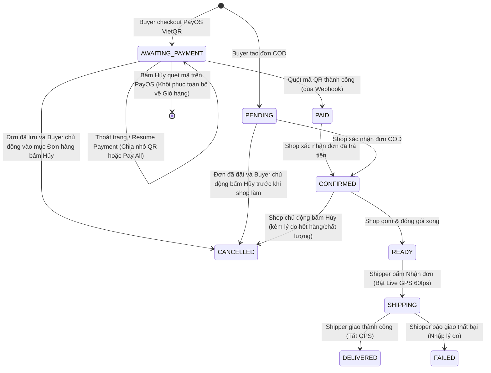

# Luồng Đơn Hàng & Theo Dõi Vận Chuyển Realtime (Order Lifecycle & Google Maps Tracking)

Tài liệu này đặc tả chi tiết toàn bộ quy trình đơn hàng và hệ thống bản đồ theo dõi vận chuyển thời gian thực (Google Maps Realtime Tracking) giữa **3 vai trò (Roles)** trong nền tảng APRP:
1. 🛒 **BUYER (Người mua hàng)**
2. 🏪 **SHOP_OWNER (Chủ cửa hàng / Nông dân)**
3. 🚚 **SHIPPER (Tài xế giao hàng)**

---

## 1. Tổng Quan Kiến Trúc Vận Hành (Architecture Overview)

```
[🛒 BUYER]
   │  1. Thêm giỏ hàng & Checkout (COD / PayOS QR)
   ▼
[📦 DATABASE / ORDER SERVICE] ── Trạng thái: PENDING
   │
   │  2. Shop xác nhận & chuẩn bị hàng
   ▼
[🏪 SHOP OWNER] ── Trạng thái: CONFIRMED ──> READY_FOR_PICKUP
   │
   │  3. Shipper nhận đơn (Ràng buộc: 1 đơn active)
   ▼
[🚚 SHIPPER] ── Trạng thái: SHIPPING
   │
   ├─► GPS Ngầm (watchPosition) HOẶC FakeGPS Demo (1.5s - 2s/lần)
   │     │
   │     ▼ WebSocket STOMP: /app/shipper/location
   │   [Spring Boot WebSocket Broker]
   │     │
   │     ▼ Broadcast Topic: /topic/order/{orderId}/location
   │
   └──► [Google Maps Realtime Tracking Modal]
         ├─ 🛒 Buyer xem lộ trình shipper giao đến nhà
         ├─ 🏪 Shop xem shipper đến kho lấy hàng
         └─ 🚚 Shipper xem lộ trình của chính mình
         (Bộ máy Lerp Animation 60fps + Xoay góc xe + Smart Camera)
```

---

## 2. Chi Tiết Từng Giai Đoạn (Step-by-Step Flow)

### Giai Đoạn 1: Buyer Thêm Sản Phẩm, Áp Mã Khuyến Mãi & Thanh Toán (Checkout)

#### 1. Thêm vào giỏ hàng (Cart Management):
* Buyer chọn các mặt hàng (Nông sản tươi lẻ, Túi mù nông sản `MysteryBox`, hoặc Combo nông sản `BuildCombo`) từ nhiều nhà vườn/shop khác nhau.
* Hệ thống lưu trữ vào bảng `cart_items` theo từng `cart_id` của Buyer (`POST /api/v1/carts/items`).
* Khi mở trang thanh toán (`/checkout`), hệ thống tự động phân loại danh sách mặt hàng gom nhóm theo từng Shop (`shopCarts`).

#### 2. Cơ chế Xem trước Đơn hàng Realtime (Checkout Preview API - `POST /api/v1/orders/preview`):
* Mỗi khi Buyer thay đổi địa chỉ nhận hàng hoặc chọn/bỏ chọn mã giảm giá, Frontend tự động gọi API `previewCheckout`:
  ```json
  {
    "shippingAddress": "268 Lý Thường Kiệt, P.14, Q.10, TP. Hồ Chí Minh",
    "voucherCodes": ["FREESHIPALL", "CAPNONG10K"],
    "cartItemIds": [1, 2, 5],
    "items": [
      { "productId": 105, "quantity": 1 },
      { "buildComboId": 1, "quantity": 1 }
    ]
  }
  ```
* **Quy trình xử lý tại Backend (`OrderServiceImpl.buildCheckoutPreview`):**
  1. **Tính cước vận chuyển từng Shop:** Dựa trên tọa độ GPS của Shop và địa chỉ người nhận qua **Google Maps Distance Matrix API** (fallback Haversine $15.000đ/shop$ nếu API bận).
  2. **Kiểm tra tính hợp lệ & quyền sở hữu Voucher:** Đảm bảo Buyer thực sự sở hữu voucher trong ví (`voucher_users`), còn hạn sử dụng, chưa vượt giới hạn dùng.
  3. **Tính toán chiết khấu & phân bổ theo chuẩn sàn TMĐT:** Trả về đối tượng `CheckoutPreviewResponse` gồm tổng tiền hàng, tổng phí ship, tổng tiền giảm, tổng thanh toán và chi tiết giảm giá theo từng shop.

#### 2.1. Cơ Chế Kiểm Soát Tồn Kho Toàn Diện & Xử Lý Tranh Chấp Đồng Thời (Multi-Item Stock Shortage & Concurrency Guard):
Nhằm mang lại trải nghiệm chuẩn mực như các sàn TMĐT lớn (Shopee / Tiki / Lazada) và giải quyết triệt để các bài toán đồng thời (Concurrency):

* **A. Phạm vi kiểm soát đồng thời trên cả 3 phân loại mặt hàng:**
  1. 🌱 **Sản phẩm nông sản thường (`PRODUCT`):** Kiểm tra số lượng tồn kho khả dụng `stockQuantity`.
  2. 🎁 **Hộp bí ẩn nông sản (`MYSTERY_BOX`):** Kiểm tra số lượng còn lại $\text{Remaining} = \max(0, \text{totalQuantity} - \text{soldQuantity})$.
  3. 🍱 **Gói combo dinh dưỡng (`BUILD_COMBO`):** Kiểm tra số lượng còn lại $\text{Remaining} = \max(0, \text{totalQuantity} - \text{soldQuantity})$.

* **B. Gom tổng số lượng đặt theo từng mã mặt hàng (`Requested Quantity Aggregation`):**
  * Trong trường hợp một mặt hàng xuất hiện ở nhiều mục khác nhau trong đơn (hoặc Buyer chọn nhiều phân loại cùng mã), hệ thống tự động cộng dồn tổng số lượng đặt theo từng ID (`productId`, `mysteryBoxId`, `buildComboId`) trước khi so khớp với kho, tránh trường hợp từng dòng riêng lẻ thì đủ nhưng tổng cộng lại vượt quá tồn kho.

* **C. Báo cáo tổng hợp toàn bộ các mặt hàng thiếu (Full Collection - Không ngắt ở món đầu tiên):**
  * Trước đây: Hệ thống dừng lại và ném lỗi ngay khi gặp món thiếu đầu tiên, khiến Buyer phải sửa giỏ hàng nhiều lần liên tiếp rất phiền toái.
  * Hiện tại: Backend quét qua **toàn bộ danh sách đơn hàng**, gom tất cả các mặt hàng không đủ số lượng vào danh sách `List<StockShortage> shortages`.
  * **Cấu trúc DTO & API Response:**
    * Mã lỗi chuẩn: `5015` (`ErrorCode.STOCK_INSUFFICIENT`).
    * Thông báo có cấu trúc bullet point rõ ràng:
      ```text
      Có 3 mặt hàng không đủ số lượng trong kho:
      • [Sản phẩm] "Cà chua bi": Kho còn 2, bạn đặt 5
      • [Hộp bí ẩn] "Hộp Bí Ẩn Trái Cây": Kho còn 0, bạn đặt 3
      • [Gói Combo] "Combo Rau Củ Eat Clean": Kho còn 1, bạn đặt 2
      Vui lòng cập nhật lại số lượng trong giỏ hàng!
      ```
    * Trường `result` trong `ApiResponse` mang danh sách chi tiết:
      ```json
      [
        {
          "itemType": "PRODUCT",
          "id": 12,
          "itemName": "Cà chua bi",
          "imageUrl": "https://...",
          "requestedQuantity": 5,
          "availableQuantity": 2
        },
        ...
      ]
      ```

* **D. Trừ kho nguyên tử chống tranh chấp đồng thời (Atomic Conditional Update & Race Condition Guard):**
  * **Bài toán thực tế:** Khi kho còn 5 kg dâu tây, Buyer A đặt 4 kg và Buyer B đặt 3 kg gần như cùng một giây. Nếu chỉ kiểm tra bằng câu lệnh SELECT thông thường (`if (stock >= qty)`), cả 2 đều thấy kho còn 5 và đều đặt thành công, dẫn đến kho bị âm hoặc giao thiếu hàng!
  * **Giải pháp triển khai:**
    * Sử dụng câu lệnh UPDATE điều kiện nguyên tử (Atomic Conditional Update) trực tiếp xuống Database:
      ```sql
      -- Cho sản phẩm thường
      UPDATE products SET stock_quantity = stock_quantity - :qty 
      WHERE product_id = :id AND stock_quantity >= :qty;

      -- Cho Hộp bí ẩn / Gói combo
      UPDATE mystery_boxes SET sold_quantity = sold_quantity + :qty 
      WHERE mystery_id = :id AND (total_quantity - sold_quantity) >= :qty;
      ```
    * Database row-level locking sẽ đảm bảo chỉ có 1 giao dịch trừ kho thành công trước (ví dụ Buyer A). Giao dịch của Buyer B trả về số dòng cập nhật $= 0$, hệ thống lập tức phát hiện thất bại do cạnh tranh, gom toàn bộ vào `raceShortages` và thông báo lịch sự:
      `"Các mặt hàng sau vừa có khách hàng khác đặt mua trước, hiện không còn đủ số lượng: • [Sản phẩm] \"Cà chua bi\"..."`

* **E. Trải nghiệm giao diện người dùng trên Frontend (`StockErrorModal`):**
  * Tự động bắt lỗi ở cả 2 thời điểm: Ngay khi Preview đơn hàng và khi bấm nút Xác nhận Đặt hàng.
  * Hiển thị Modal chuyên nghiệp chuẩn sàn TMĐT:
    * Header với icon động `PackageX` và badge đếm tổng số mặt hàng cần điều chỉnh.
    * Danh sách Card cuộn mượt mà hiển thị đầy đủ hình ảnh thumbnail thực tế của từng món.
    * Badge phân loại nổi bật: 🌱 **Nông sản** (Xanh lá), 🎁 **Hộp bí ẩn** (Tím), 🍱 **Gói Combo** (Cam).
    * Tag trực quan so sánh: `Bạn đặt: X` đối chiếu với `Kho chỉ còn: Y` (hoặc `Hết hàng (0)` viền đỏ cảnh báo).
    * Nút hành động 1 chạm: `[ 🛒 Về giỏ hàng cập nhật ]` điều hướng thẳng về `/cart`.
    * Shortcut button trên Sidebar: Cho phép Buyer mở lại danh sách lỗi bất cứ lúc nào nếu lỡ tay đóng modal.

#### 3. Cơ Chế Khuyến Mãi & Voucher Stacking Chuẩn Sàn TMĐT (Shopee / Lazada Architecture):
Để giải quyết bài toán sàn nhiều nhà bán (Multi-vendor Marketplace), hệ thống áp dụng cơ chế Stacking (kết hợp đồng thời nhiều mã) với các phân định chặt chẽ:

* **A. Phân loại Voucher theo Phạm vi (`VoucherScope`) & Mục tiêu (`VoucherTarget`):**
  * `VoucherScope`:
    * `PLATFORM` / `SYSTEM`: Voucher do **Admin Sàn phát hành** (áp dụng toàn sàn).
    * `SHOP`: Voucher do **Từng Nhà vườn/Shop tự phát hành** (chỉ áp dụng cho sản phẩm của shop đó).
  * `VoucherTarget`:
    * `SHIPPING`: Giảm cước phí vận chuyển (Freeship).
    * `ORDER`: Giảm trực tiếp vào tiền mua nông sản.
  * `VoucherType`:
    * `FIXED_AMOUNT`: Giảm số tiền cố định (Ví dụ: Giảm 10.000đ).
    * `PERCENTAGE`: Giảm theo tỷ lệ phần trăm kèm mức giảm tối đa (Ví dụ: Giảm 10%, tối đa 25.000đ).
    * `FREE_SHIPPING`: Miễn phí vận chuyển (Ví dụ: Giảm tối đa 30.000đ phí ship).

* **B. Quy tắc Stacking trên 1 lần Đặt hàng:**
  Khách hàng được áp dụng đồng thời:
  $$\text{Mã Khuyến Mãi Hợp Lệ} = \text{1 Voucher Freeship Sàn} + \text{1 Voucher Đơn Hàng Sàn} + \text{1 Voucher Riêng Của Từng Shop}$$
  *(Nếu chọn mã cùng nhóm, mã mới sẽ tự động thay thế mã cũ tương ứng).*

* **C. Quy tắc Kiểm tra Giá trị Đơn tối thiểu (`minOrderValue`):**
  * **Với Voucher Toàn Sàn (`PLATFORM` / `FREESHIP`):** Điều kiện `minOrderValue` được so sánh với **Tổng Tiền Hàng Của Toàn Bộ Giỏ Hàng (`totalGoodsAmount`)**.  
    *Ví dụ: Mã `FREESHIPALL` yêu cầu đơn 100k $\rightarrow$ Chỉ cần tổng tiền rau củ của cả Shop 1 + Shop 2 $\ge$ 100k là đủ điều kiện, không ép từng shop riêng lẻ phải đủ 100k.*
  * **Với Voucher Của Shop (`SHOP`):** Điều kiện `minOrderValue` được so sánh với **Tiền Hàng Của Chính Shop Đó (`shopGoodsAmount`)**.

* **D. Công thức Tính Giảm Giá & Phân Bổ Chiết Khấu (Discount Allocation):**
  * **Voucher Freeship:**
    $$\text{Discount} = \min(\text{discountValue}, \text{totalShippingFee})$$
    *(Tiền giảm freeship không bao giờ vượt quá phí ship thực tế).*
  * **Voucher Giảm Tiền Hàng Sàn:** Khi giảm toàn sàn, mức giảm được chia sẻ (pro-rata) cho từng đơn của shop theo tỷ lệ doanh thu:
    $$\text{ShopShare} = \text{PlatformDiscount} \times \frac{\text{GoodsAmount}_{\text{shop}}}{\text{TotalGoodsAmount}}$$

#### 4. Phân Định Trách Nhiệm Tài Chính & Dòng Tiền Ví (Wallet & Settlement Model Giữa 4 Roles):
Hệ thống thiết kế theo kiến trúc 2 tầng độc lập: **Tầng Đơn Hàng (Order Checkout)** và **Tầng Quyết Toán Ví (Settlement - Khi đơn `COMPLETED`)**:

| Loại Khuyến Mãi | Nguồn Tài Trợ (Ai chịu chi phí?) | Tác Động Khi Checkout (Buyer) | Dòng Tiền Khi Quyết Toán Ví (Sau khi Giao Hàng Thành Công) |
| :--- | :--- | :--- | :--- |
| **Voucher của Shop** *(VD: CAPNONG10K)* | **Shop tự chịu** | Giảm trực tiếp tiền thanh toán của đơn Shop đó. | Shop chỉ nhận về: `Tiền hàng - Voucher Shop - Phí hoa hồng sàn`. Ví Admin không phải bù. |
| **Voucher Đơn hàng Sàn** *(VD: PLATFORM15K)* | **Admin (Sàn) tài trợ** | Giảm vào tổng tiền đơn hàng của Buyer. | Sàn trích từ **Quỹ Marketing / Ví Admin** bù lại cho Shop, đảm bảo Shop vẫn nhận đủ 100% doanh thu tiền hàng. |
| **Voucher Freeship** *(VD: FREESHIPALL)* | **Admin (Sàn) tài trợ** | Giảm cước vận chuyển Buyer phải trả. | **Shipper vẫn nhận đủ 100% cước phí giao hàng** (Phần Buyer trả + Phần Sàn bù từ Ví Admin vào Ví Shipper). |

> **Lưu ý kiến trúc:** Nhờ lưu độc lập các cột `shop_discount_amount`, `batch_discount_amount`, `shipping_discount_amount` vào bảng `orders`, luồng Checkout Đơn hàng hoàn toàn độc lập với luồng Ví tiền. Khi module Wallet hoàn thành, chỉ cần gọi hàm quyết toán đọc lại các số liệu này để cộng/trừ ví.

#### 5. Lựa chọn phương thức thanh toán (Payment Method Execution):
* **Phương thức 1: COD (Thanh toán khi nhận hàng)**:
  * Đơn hàng được tạo thành công ngay lập tức ở trạng thái **`PENDING`**.
  * Cửa hàng nhận được thông báo đơn hàng mới để xác nhận.
* **Phương thức 2: PayOS (Thanh toán trực tuyến quét mã VietQR)**:
  * Khi Buyer bấm đặt hàng, hệ thống tạo đơn ở trạng thái **`AWAITING_PAYMENT`** (Chờ thanh toán).
  * **Cơ chế Ghép đơn nhiều Shop (`CheckoutBatch`)**:
    * Nếu trong giỏ hàng có sản phẩm từ nhiều shop khác nhau, Backend gom các đơn hàng con vào một thực thể **`CheckoutBatch`**.
    * Hệ thống tổng hợp số tiền các đơn và gọi PayOS API tạo một liên kết thanh toán (`checkoutUrl`) kèm mã VietQR chung cho toàn bộ batch.
    * Buyer được điều hướng sang cổng thanh toán VietQR PayOS.
  * **Trường hợp 1 - Quét mã thanh toán thành công ngay lập tức:**
    * Cổng PayOS gửi Webhook callback về Backend (`POST /orders/webhook/payos`).
    * Backend kiểm tra chữ ký (`payOS.webhooks().verify`), gọi hàm `settlePaidOrderCode()`:
      * Cập nhật bản ghi `Payment` sang trạng thái `PAID`.
      * Cập nhật toàn bộ các đơn hàng trong Batch từ **`AWAITING_PAYMENT`** $\rightarrow$ **`PAID`**.
      * Đánh dấu `CheckoutBatch` là `COMPLETED`.
      * Các Shop nhận thông báo đơn hàng đã thanh toán để bắt đầu chuẩn bị nông sản.
    * **Cơ chế Idempotency & Chống Gửi Email Hóa Đơn Trùng Lặp (Duplicate Webhook & Email Guard):**
      * Khi Buyer thanh toán xong, hệ thống nhận được 2 luồng sự kiện gần như cùng lúc: (1) Webhook từ server PayOS và (2) Trình duyệt của Buyer được chuyển hướng về trang kết quả (`/payment/result`) gọi API `confirmPayment`.
      * Để tránh việc cả 2 luồng đều xử lý và gửi 2 email hóa đơn trùng lặp về hộp thư Gmail của Buyer:
        * Backend áp dụng cơ chế kiểm tra trạng thái nguyên tử: Hàm `settlePaidOrderCode()` kiểm tra nếu đơn hàng đã ở trạng thái `PAID`, hệ thống lập tức bỏ qua và không kích hoạt lại các tác vụ phụ.
        * `EmailServiceImpl` bảo vệ bằng cờ gửi hóa đơn, đảm bảo hóa đơn điện tử đính kèm chi tiết nông sản chỉ được gửi **đúng 1 lần duy nhất** đến Gmail của người mua.
  * **Trường hợp 2 - Đang ở cổng PayOS nhưng Buyer bấm "Hủy thanh toán":**
    * Khi đang ở màn hình quét mã VietQR PayOS, nếu Buyer chủ động bấm nút *"Hủy thanh toán"* (Cancel):
    * **Đơn hàng chưa qua bước thanh toán thành công, nên KHÔNG trở thành đơn `CANCELLED`**.
    * **Hệ thống tự động KHÔI PHỤC toàn bộ sản phẩm trở về lại Giỏ hàng (Cart)** để Buyer không bị mất sản phẩm, có thể tiếp tục xem hàng, thay đổi số lượng hoặc chọn lại phương thức thanh toán khác (như COD).
    * Giao dịch PayOS tạm thời được hủy bỏ (voided/discarded), tránh làm rác danh sách lịch sử đơn hàng của người dùng.
  * **Trường hợp 3 - Buyer vô tình thoát trang / rớt mạng / chưa kịp quét mã:**
    * Nếu Buyer không bấm hủy mà vô tình đóng trình duyệt, rớt mạng hoặc muốn để dành thanh toán sau:
    * **Đơn hàng ĐƯỢC GIỮ NGUYÊN ở trạng thái `AWAITING_PAYMENT` (Chờ thanh toán)** trong mục *"Đơn Hàng Của Tôi"* (`/buyer/orders`).
    * Lúc này sản phẩm đã được tạm giữ để tránh người khác mua hết. Cửa hàng chưa xử lý vì hệ thống đang chờ thanh toán.
    * **Tính năng Thanh toán lại (`Resume Payment`) & Chia nhỏ mã QR:**
      * Buyer vào lại mục "Đơn hàng của tôi", bấm nút **`[ 💳 Thanh toán ngay ]`**.
      * **Nếu là đơn ghép nhiều Shop (`CheckoutBatch`)**: Hệ thống gọi API `GET /api/v1/payments/order/{orderId}/resume-options` và hiển thị Modal Tùy Chọn:
        1. **Thanh toán gộp toàn bộ (Pay All)**: Dùng 1 mã VietQR chung duy nhất để thanh toán toàn bộ các đơn hàng chưa trả trong batch.
        2. **Chia nhỏ mã QR thanh toán từng đơn (Split Payment)**: Cho phép Buyer chọn thanh toán riêng cho từng đơn của từng Shop cụ thể (hệ thống tự sinh mã VietQR lẻ ứng với số tiền của shop được chọn).
  * **Trường hợp 4 - Khi nào đơn hàng MỚI VỀ TRẠNG THÁI `CANCELLED`?**:
    * Trạng thái **`CANCELLED`** (Đã hủy) **CHỈ XẢY RA KHI ĐƠN HÀNG ĐÃ ĐƯỢC ĐẶT THÀNH CÔNG VÀO HỆ THỐNG**, sau đó xảy ra việc hủy đơn:
      * **Buyer chủ động hủy:** Đơn COD (đang ở `PENDING`) hoặc đơn PayOS (ở `AWAITING_PAYMENT`/`PAID`), Buyer vào "Đơn hàng của tôi" bấm **`[ ✕ Hủy đơn ]`** trước khi Shop tiến hành đóng gói/giao hàng.
      * **Shop chủ động hủy:** Cửa hàng vào Quản lý đơn, bấm **`[ Hủy đơn ]`** kèm lý do chính đáng (hết hàng thu hoạch đột xuất, nông sản không đạt chuẩn chất lượng tươi...).
      * **Giao hàng thất bại:** Shipper không thể liên lạc hoặc khách từ chối nhận, đơn chuyển `FAILED` $\rightarrow$ `CANCELLED`.
    * Lúc này, đơn hàng mới được lưu với trạng thái **`CANCELLED`** trong lịch sử đơn hàng để quản lý và giải phóng tồn kho (Inventory rollback) về lại cho Shop.

---

### Giai Đoạn 2: Shop Tiếp Nhận, Xác Nhận & Chuẩn Bị Hàng

1. **Xem danh sách & chi tiết đơn hàng:**
   * Shop Owner vào màn hình quản lý đơn (`/shop/orders`).
   * Bấm vào từng đơn để xem modal chi tiết [`OrderDetailModal.tsx`](file:///d:/SEP/APRP-FE/src/features/shop/components/OrderDetailModal.tsx).
2. **Xác nhận đơn hàng:**
   * Shop bấm **"Xác nhận đơn"**: Backend cập nhật trạng thái đơn thành **`CONFIRMED`**.
3. **Chuẩn bị hàng:**
   * Shop tiến hành thu hoạch, đóng gói nông sản.
   * Khi đóng gói xong, Shop chuyển đơn sang trạng thái sẵn sàng giao (Sẵn sàng để Shipper tới nhận).

---

### Giai Đoạn 3: Shipper Tiếp Nhận Đơn Hàng & Đi Giao

Màn hình điều khiển Shipper: [`Dashboard.tsx`](file:///d:/SEP/APRP-FE/src/pages/shipper/Dashboard.tsx).

#### 1. Trạng thái Online / Offline:
* Shipper có nút gạt Trực tuyến (Online) / Ngoại tuyến (Offline).
* Chỉ khi Shipper bật **Trực tuyến**, hệ thống mới phân bổ và cho phép nhận các đơn hàng mới trong khu vực.

#### 2. Quy tắc cốt lõi: Ràng buộc 1 đơn active duy nhất (Single Active Order):
* **Lý do nghiệp vụ:** Trong thực tế vận chuyển nông sản tươi sống và để trải nghiệm tracking GPS chuẩn xác (không bị lẫn lộn vị trí giữa 3 shop và 3 buyer khác nhau), Shipper **bắt buộc chỉ được nhận 1 đơn hàng tại một thời điểm**.
* **Xử lý Backend:** Trong [`OrderServiceImpl.java`](file:///d:/SEP/APRP-BE/src/main/java/com/sang/be_capnong/service/impl/OrderServiceImpl.java), hàm nhận đơn kiểm tra nếu shipper đã có đơn ở trạng thái `SHIPPING`, lập tức chặn với mã lỗi:
  ```java
  throw new AppException(ErrorCode.SHIPPER_HAS_ACTIVE_ORDER); // 400 Bad Request
  ```
* **Xử lý Frontend:** Tại tab "Đơn hàng mới", nếu `myOrders.length > 0`:
  * Nút "Nhận đơn" bị vô hiệu hóa (disabled).
  * Hiển thị thông báo màu vàng: *"Bạn đang có đơn hàng đang giao. Hãy hoàn thành hoặc hủy đơn hiện tại trước khi nhận đơn mới."*

#### 3. Chuyển đổi mượt mà khi nhận đơn (Optimistic UI):
* Khi Shipper bấm **[ Nhận đơn ]**:
  * Đơn hàng ngay lập tức biến mất khỏi danh sách "Đơn hàng mới" và tự động xuất hiện ở tab "Đang giao".
  * Trạng thái đơn chuyển sang **`SHIPPING`**.

#### 4. Giao diện xử lý tại tab "Đang giao":
* Được thiết kế chuẩn sàn giao hàng hiện đại với **2 nút tác vụ ngang hàng cân xứng**:
  * `[ ✅ Giao thành công ]` *(Nền xanh lá lá)*: Mở popup xác nhận thành công $\rightarrow$ Chuyển trạng thái đơn sang **`DELIVERED`**.
  * `[ ❌ Giao thất bại ]` *(Nền đỏ)*: Mở popup yêu cầu nhập lý do giao thất bại (Khách không nhận, sai địa chỉ, không liên lạc được...) $\rightarrow$ Chuyển trạng thái sang **`FAILED`** hoặc hoàn kho.
* **2 Nút tiện ích phụ trợ:**
  * `[ 🗺️ Xem Bản Đồ Map ]`: Mở trực tiếp Google Maps Tracking Modal để tài xế xem tuyến đường dẫn đường.
  * `[ 🎭 Mở Demo GPS ]`: Bật công cụ mô phỏng GPS xe chạy tự động (phục vụ thuyết trình/bảo vệ đồ án).

---

### Giai Đoạn 4: Định Vị GPS & Kiến Trúc WebSocket Realtime

```
[Thiết bị Shipper]
   │
   ├─► A. Chế độ thực tế: navigator.geolocation.watchPosition (mỗi 1.5s - 2s)
   │
   └─► B. Chế độ Demo: FakeGPS phát tọa độ chạy dọc tuyến đường
         │
         ▼
   STOMP Client (SockJS URL: /ws hoặc /api/v1/ws)
         │  Destination: /app/shipper/location
         ▼
   [ShipperWebSocketController.java]
         │
         ├─► Cập nhật vị trí mới nhất vào DB (latitude, longitude, updatedAt)
         │
         ▼  Broadcast Topic:
   /topic/order/{orderId}/location
         │
   ┌─────┴────────────────────────┐
   ▼                              ▼
[Buyer Modal]               [Shop Owner Modal]
```

#### Payload dữ liệu truyền tải (JSON):
```json
{
  "orderId": 105,
  "shipperId": 3,
  "shipperName": "Nguyễn Văn Giao",
  "shipperPhone": "0987654321",
  "vehicleNumber": "59-X1 888.88",
  "latitude": 10.7769,
  "longitude": 106.7009,
  "shopLatitude": 10.7801,
  "shopLongitude": 106.6990,
  "shopName": "Nông Sản Sạch Đà Lạt",
  "destinationLatitude": 10.7712,
  "destinationLongitude": 106.7050,
  "recipientName": "Trần Thị Mua",
  "isFake": false,
  "gpsOff": false,
  "updatedAt": "2026-10-10T12:00:00Z"
}
```

---

### Giai Đoạn 5: Trải Nghiệm Bản Đồ Google Maps Trên Cả 3 Role

Modal hiển thị dùng chung: [`GoogleMapTrackingModal.tsx`](file:///d:/SEP/APRP-FE/src/components/map/GoogleMapTrackingModal.tsx).

#### Điểm truy cập của từng Role:
1. **🛒 BUYER:** Vào mục "Đơn hàng của tôi" $\rightarrow$ bấm nút `[ 🗺️ Theo dõi lộ trình (Map) ]`.
2. **🏪 SHOP OWNER:** Vào mục "Quản lý đơn hàng" $\rightarrow$ mở chi tiết đơn $\rightarrow$ bấm nút `[ 🗺️ Xem lộ trình Shipper (Google Maps) ]`.
3. **🚚 SHIPPER:** Vào tab "Đang giao" $\rightarrow$ bấm nút `[ 🗺️ Xem Bản Đồ Map ]`.

---

## 3. Vì Sao Bản Đồ Cũ Bị Giật & Cách Bản Mới Giải Quyết Triệt Để

| Vấn đề ở dự án cũ (Leaflet / OSRM) | Nguyên nhân kỹ thuật | Giải pháp đã hoàn thiện trên Google Maps mới |
| :--- | :--- | :--- |
| **Marker bị giật cóc (Jump)** | Mỗi lần nhận gói WS (mỗi 2s), code cũ gọi thẳng `setLatLng([lat, lng])`, làm marker biến mất ở điểm A và xuất hiện ngay ở điểm B. | **Bộ máy nội suy Lerp 60fps (`requestAnimationFrame`):** Khi có tọa độ mới, marker trượt mượt mà từ A đến B trong 1.5s với hàm làm mượt cubic ease-out. |
| **Xe không quay đầu theo hướng đi** | Icon xe máy cố định một góc dù rẽ trái hay rẽ phải. | **Tự động tính góc Bearing $\theta$:** Sử dụng công thức lượng giác cầu tính góc giữa tọa độ trước và tọa độ sau, tự động xoay SVG biểu tượng xe máy đúng hướng di chuyển. |
| **Bản đồ rung lắc liên tục** | Mỗi tick tọa độ tới đều ép `map.fitBounds()` hoặc `panTo()`, camera co giãn liên tục. | **Smart Camera:** Bản đồ chỉ tự động căn chỉnh vùng bao (`fitBounds`) **đúng 1 lần duy nhất** lúc mở modal. |
| **Camera cướp quyền người dùng** | Khi người dùng dùng chuột kéo bản đồ để xem địa chỉ nhà/shop, camera lập tức giật về vị trí xe. | **Cơ chế chống giằng co:** Hệ thống phát hiện sự kiện kéo (`dragstart`), tạm dừng bám theo trong 4s. Cung cấp nút gạt trực quan: `[ 🎯 Đang bám theo tài xế ]` $\leftrightarrow$ `[ 🖐️ Chế độ xem tự do ]`. |
| **Tuyến đường không khớp thực tế** | Dùng OSRM public server (`router.project-osrm.org`) thường xuyên timeout, chậm hoặc vẽ đường chim bay. | Tích hợp **Google Maps DirectionsService** (`TravelMode.DRIVING`), vẽ tuyến đường chuẩn xác theo hệ thống giao thông Việt Nam. |
| **Xử lý khi shipper dừng GPS** | Khi shipper hoàn thành đơn hoặc tắt GPS, marker đứng im hoặc web bị treo. | Xử lý cờ `gpsOff: true`, hiển thị toast cảnh báo màu vàng: *"Shipper đang tạm dừng phát tín hiệu GPS"*. |

---

## 4. Bảng Trạng Thái Đơn Hàng (Order Status State Machine)



---

## 5. Bảng Tổng Hợp API Endpoints & WebSocket Topics

### REST APIs:
| Phương thức | Đường dẫn | Quyền | Mục đích |
| :--- | :--- | :--- | :--- |
| `POST` | `/api/v1/orders/preview` | BUYER | Xem trước đơn hàng, tính phí ship từng shop & tiền giảm voucher realtime |
| `POST` | `/api/v1/orders/checkout` | BUYER | Tạo đơn hàng mới & lấy link thanh toán PayOS (nếu chọn QR) |
| `GET` | `/api/v1/vouchers/my-vouchers` | BUYER | Lấy danh sách voucher Buyer đang sở hữu trong ví |
| `GET` | `/api/v1/vouchers/public` | BUYER / Public | Lấy danh sách voucher công khai để thu thập |
| `POST` | `/api/v1/vouchers/{id}/claim` | BUYER | Thu thập / lưu voucher vào ví của Buyer |
| `POST` | `/api/v1/payments/{orderCode}/cancel` | BUYER / Public | Hủy thanh toán PayOS (hoàn tồn kho cho Shop và khôi phục hàng về Giỏ cho Buyer) |
| `GET` | `/api/v1/payments/order/{orderId}/resume-options` | BUYER | Lấy tùy chọn tiếp tục thanh toán (thanh toán gộp hoặc chia nhỏ mã QR từng đơn) |
| `POST` | `/api/v1/payments/{orderCode}/confirm` | BUYER / Public | Xác thực thanh toán sau khi PayOS chuyển hướng về |
| `POST` | `/api/v1/payments/payos/webhook` | Hệ thống (PayOS) | Nhận callback thanh toán tự động |
| `PUT` | `/api/v1/orders/{orderId}/cancel` | BUYER / SHOP | Hủy đơn hàng đã tạo trước khi giao hàng (hoàn kho và khôi phục giỏ nếu chưa trả tiền) |
| `GET` | `/api/v1/shippers/location/order/{orderId}` | BUYER / SHOP / SHIPPER | REST fallback lấy vị trí gần nhất của shipper khi vừa mở modal |

### WebSocket (STOMP over SockJS):
* **Endpoint kết nối:** `/ws` hoặc `/api/v1/ws` (hỗ trợ JWT header trong handshake).
* **Destination gửi vị trí (Shipper):**
  * `destination`: `/app/shipper/location`
* **Destination lắng nghe (Buyer, Shop, Shipper):**
  * `topic`: `/topic/order/{orderId}/location`

---

## 6. Hướng Dẫn Kiểm Thử Đầy Đủ (Testing Guide Cho Team Member)

Để kiểm tra toàn bộ luồng hoạt động mượt mà từ đầu đến cuối:

1. **Bước 1 (Buyer):**
   * Đăng nhập tài khoản Buyer, chọn sản phẩm cho vào giỏ hàng.
   * Tiến hành đặt hàng với phương thức COD $\rightarrow$ Đơn tạo ở trạng thái `PENDING`.
2. **Bước 2 (Shop Owner):**
   * Đăng nhập tài khoản Shop của sản phẩm trên, vào trang đơn hàng.
   * Xác nhận đơn hàng $\rightarrow$ Đơn chuyển sang sẵn sàng cho shipper.
3. **Bước 3 (Shipper):**
   * Đăng nhập tài khoản Shipper, bật trạng thái **"Trực tuyến"**.
   * Tại tab "Đơn hàng mới", bấm **[ Nhận đơn ]** $\rightarrow$ Đơn lập tức nhảy sang tab "Đang giao".
   * Kiểm tra ràng buộc: Quay lại tab "Đơn hàng mới", các đơn khác sẽ không thể nhận được nữa (nút bị mờ kèm thông báo vàng).
   * Bấm **[ 🎭 Mở Demo GPS ]** $\rightarrow$ Bấm **Bắt đầu** để kích hoạt xe mô phỏng chạy trên tuyến đường.
4. **Bước 4 (Quan sát Realtime trên 3 trình duyệt / 3 tab):**
    * **Tab Buyer:** Bấm `[ 🗺️ Theo dõi lộ trình (Map) ]`.
   * **Tab Shop:** Bấm `[ 🗺️ Xem lộ trình Shipper (Google Maps) ]`.
   * **Tab Shipper:** Bấm `[ 🗺️ Xem Bản Đồ Map ]`.
   * **Kết quả kỳ vọng:** Biểu tượng xe máy màu xanh lá lướt êm ái 60fps trên đường đi, xoay đầu xe theo các khúc cua, không bị nhảy cóc, bản đồ không rung lắc khi người dùng kéo rê chuột.
5. **Bước 5 (Hoàn thành):**
   * Shipper bấm **[ ✅ Giao thành công ]** $\rightarrow$ Đơn hoàn tất, bản đồ tự động dọn dẹp kết nối an toàn.

6. **Bước 6 (Kiểm thử Cảnh Báo Thiếu Tồn Kho Toàn Diện & Tranh Chấp Đồng Thời):**
   * **Test Case A (Nhiều mặt hàng cùng hết/thiếu kho):** Chọn vào giỏ hàng 1 Sản phẩm lẻ (đặt 5 kg, kho chỉ còn 2 kg), 1 Hộp bí ẩn (đặt 2 hộp, kho còn 0 hộp), 1 Gói Combo (đặt 3 gói, kho còn 1 gói). Bấm Đặt hàng $\rightarrow$ Hệ thống lập tức mở `StockErrorModal` hiển thị danh sách đầy đủ cả 3 mặt hàng cùng ảnh, badge loại và số lượng so sánh thay vì chỉ báo 1 món.
   * **Test Case B (Tranh chấp đồng thời - Race Condition):** Mở 2 tab trình duyệt cho 2 tài khoản Buyer khác nhau cùng mua mặt hàng chỉ còn số lượng 1 trong kho $\rightarrow$ Buyer bấm trước mua thành công; Buyer bấm sau lập tức nhận thông báo mặt hàng vừa có khách khác mua trước.

---

## 7. Chuẩn Hóa An Toàn Kiến Trúc Backend (Architecture & Code Quality Standards)

Để hệ thống hoạt động ổn định và sẵn sàng cho môi trường Production quy mô lớn, các quy chuẩn lập trình sau đã được áp dụng chặt chẽ trên toàn bộ source code Backend:

1. **Chuẩn Hóa So Sánh ID Thực Thể Với `Objects.equals(...)`:**
   * **Vấn đề tiềm ẩn:** Trong ngôn ngữ Java, toán tử `==` hoặc `!=` khi dùng cho các kiểu đối tượng Wrapper (`Long`, `Integer`) chỉ so sánh tham chiếu ô nhớ. Cơ chế **Integer Cache** của JVM chỉ cache các giá trị từ `-128` đến `127`.
   * **Hậu quả nếu dùng `!=`:** Khi hệ thống có trên 127 người dùng (User ID $\ge 128$), câu lệnh `if (order.getShop().getId() != currentUser.getId())` sẽ luôn trả về `true` (do 2 đối tượng Integer nằm ở 2 ô nhớ khác nhau), dẫn đến lỗi từ chối quyền truy cập (`UNAUTHORIZED 401`) sai lệch nghiêm trọng!
   * **Giải pháp chuẩn hóa:** Toàn bộ các phép kiểm tra quyền hạn (Buyer, Shop, Shipper, Admin) trên tất cả các Service (`OrderServiceImpl`, `ProductServiceImpl`, `BlogServiceImpl`, `VoucherServiceImpl`...) đều được chuẩn hóa 100% bằng:
     ```java
     if (!Objects.equals(order.getShop().getId(), currentUser.getId())) {
         throw new AppException(ErrorCode.UNAUTHORIZED);
     }
     ```

2. **Bổ Sung Dữ Liệu Quyết Toán Tiền Mặt COD (COD Financial Attributes):**
   * Schema bảng `orders` được bổ sung các cột phục vụ quyết toán dòng tiền rõ ràng giữa Sàn, Shipper và Shop:
     * `cod_amount`: Tiền mặt tài xế cần thu hộ từ khách.
     * `cod_prepaid_amount`: Tiền người mua đã trả trước qua cổng thanh toán (nếu có).
     * `cod_settled`: Cờ boolean đánh dấu Shipper đã nộp lại tiền mặt COD về cho Sàn hay chưa.
     * `cod_settled_at`: Thời điểm Shipper nộp tiền mặt về Sàn.
     * `cod_refunded_at`: Thời điểm hoàn tiền mặt cho Buyer nếu phát sinh sự cố.
     * `shipper_paid_at`: Thời điểm Sàn thanh toán tiền công cước giao hàng vào Ví của Shipper.

3. **Chuẩn Hóa Bộ Mã Tiếng Việt UTF-8 Database Connection:**
   * Cấu hình kết nối JDBC trong `application.yml` (`application-local.yml` và `application-server.yml`) được bổ sung các tham số bắt buộc:
     `useUnicode=true&characterEncoding=UTF-8&serverTimezone=Asia/Ho_Chi_Minh`
   * Toàn bộ file migration SQL (`sep.sql`) bắt đầu với chỉ thị `SET NAMES utf8mb4;` nhằm bảo toàn tuyệt đối tiếng Việt có dấu, không bao giờ bị lỗi font như `Ng ┴` khi import dữ liệu mẫu.
