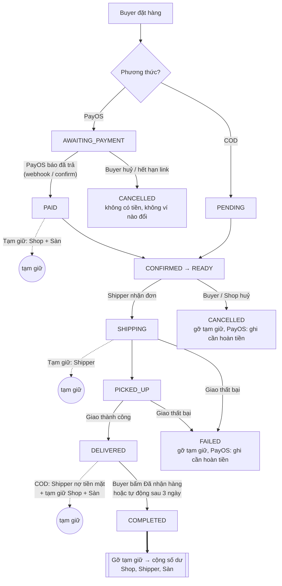
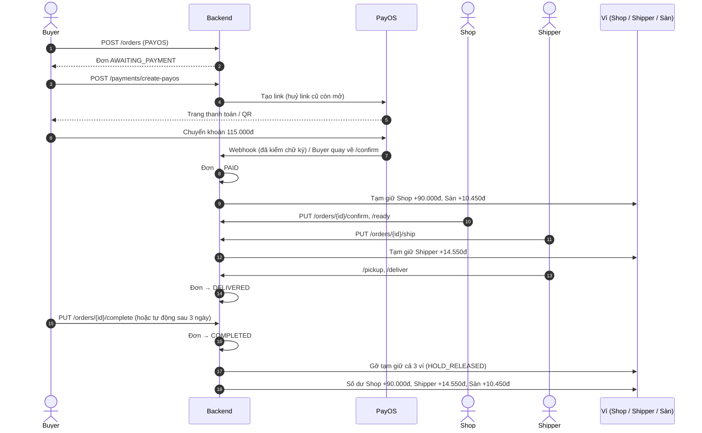
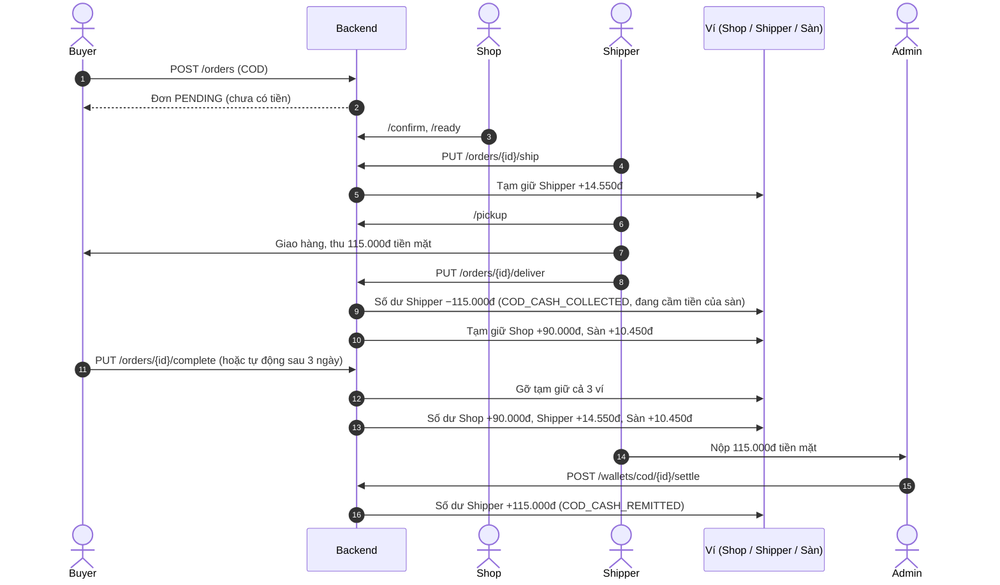
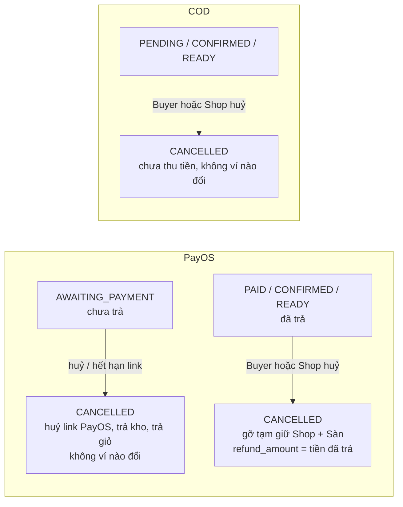
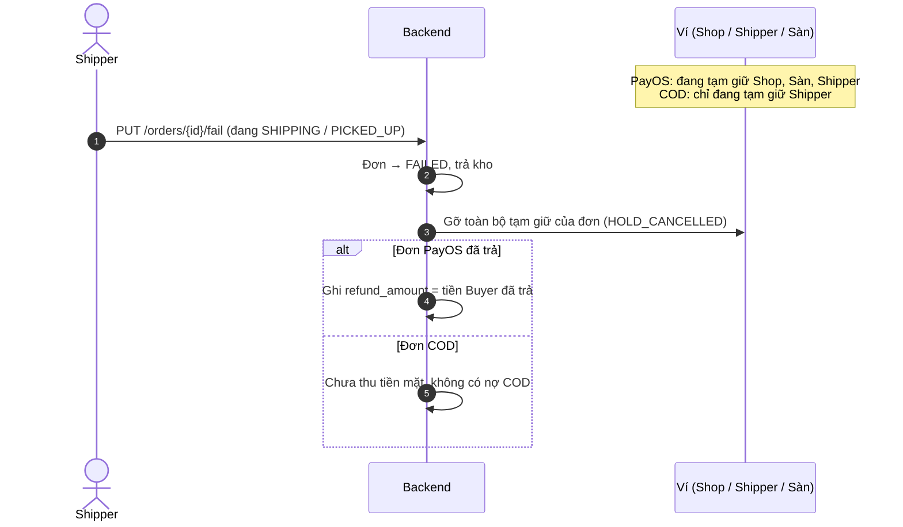
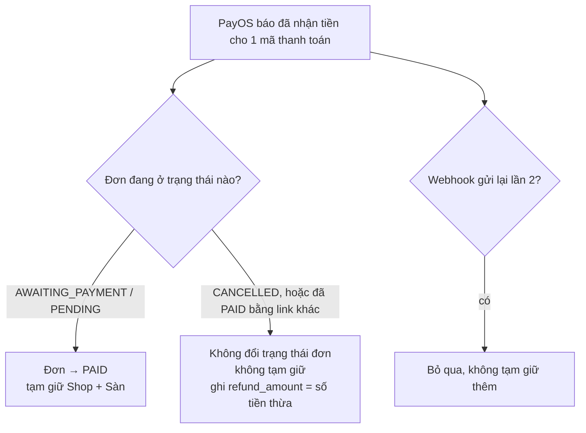
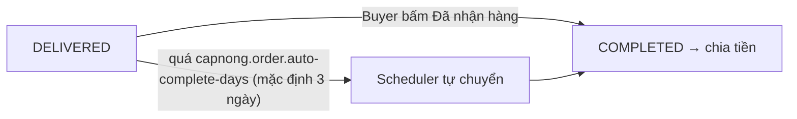

# Luồng tiền: từ lúc Buyer thanh toán đến lúc chia vào ví

Tài liệu này mô tả từng bước dòng tiền của 1 đơn hàng, cho mọi trường hợp (PayOS trả trước 100%, COD, huỷ, giao thất bại, trả tiền muộn, tự hoàn tất).
Công thức chia tiền và danh sách API chi tiết: xem [`wallet-settlement-flow.md`](wallet-settlement-flow.md).

Căn cứ: đặc tả FA26SE031 mục *Payment, Fees, and Referral System* ("distributes transaction fees once an order is successfully completed") và [`order-and-tracking-flow.md`](order-and-tracking-flow.md) mục 4 (quyết toán ví khi đơn `COMPLETED`).

---

## 1. Ba khái niệm cần nắm

| Khái niệm | Cột DB | Ý nghĩa |
|---|---|---|
| **Số dư** (rút được) | `wallets.total_balance` | Tiền thật của Shop / Shipper / Sàn. Chỉ tăng khi đơn `COMPLETED`. |
| **Tạm giữ** | `wallets.frozen_balance` | Phần tiền của đơn chưa hoàn tất. Hiện ngay cho người dùng thấy, **chưa rút được**. |
| **Sổ cái** | bảng `wallet_transactions` | Mỗi lần cộng/trừ ví là 1 dòng. Mỗi (ví, đơn, loại bút toán) chỉ ghi 1 lần → chạy lại không cộng trùng. |

Quy tắc chung:

1. Tiền vào sàn → **tạm giữ** phần của từng bên.
2. Đơn `COMPLETED` → **gỡ tạm giữ** (`HOLD_RELEASED`) và **cộng số dư** (`*_INCOME`, `PLATFORM_*`).
3. Đơn huỷ / giao thất bại → **gỡ tạm giữ** (`HOLD_CANCELLED`), không cộng gì. Đơn đã trả online thì ghi `orders.refund_amount` để Admin hoàn tiền.

---

## 2. Ví dụ số dùng xuyên suốt

Tiền hàng **100.000đ**, phí ship **15.000đ**, không voucher → Buyer trả **115.000đ**.

| Bên | Công thức | Nhận |
|---|---|---|
| Shop | 100.000 − 10% × 100.000 | **90.000đ** |
| Shipper | 15.000 − 3% × 15.000 | **14.550đ** |
| Sàn | 115.000 − 90.000 − 14.550 | **10.450đ** (= 10.000 phí nông dân + 450 phí shipper) |
| **Tổng** | | **115.000đ** = tiền Buyer trả |

Có voucher (đã test): tiền hàng 100.000đ, ship 15.000đ, voucher shop 10.000đ, voucher sàn 20.000đ, freeship sàn 10.000đ → Buyer trả 75.000đ → Shop 81.000đ, Shipper 14.550đ, Sàn −20.550đ (sàn bù voucher nhiều hơn phí thu được).

---

## 3. Tổng quan theo trạng thái đơn

---

## 4. Trường hợp 1: PayOS trả trước 100%, giao thành công

Biến động ví:

| Bước | Shop (tạm giữ / số dư) | Shipper (tạm giữ / số dư) | Sàn (tạm giữ / số dư) |
|---|---|---|---|
| PayOS báo đã trả | +90.000 / 0 | 0 / 0 | +10.450 / 0 |
| Shipper nhận đơn | 90.000 / 0 | +14.550 / 0 | 10.450 / 0 |
| COMPLETED | 0 / **+90.000** | 0 / **+14.550** | 0 / **+10.450** |

---

## 5. Trường hợp 2: COD, giao thành công

Biến động ví Shipper:

| Bước | Tạm giữ | Số dư | Ghi chú |
|---|---|---|---|
| Nhận đơn | +14.550 | 0 | |
| Giao thành công | 14.550 | **−115.000** | Âm = đang nợ sàn tiền mặt |
| COMPLETED | 0 | −100.450 | +14.550 tiền cước |
| Admin xác nhận đã nộp | 0 | **14.550** | Còn đúng tiền cước |

Shop và Sàn giống trường hợp PayOS, chỉ khác là bắt đầu tạm giữ lúc Shipper giao thành công (lúc đó tiền mặt mới thật sự được thu).

---

## 6. Trường hợp 3: Huỷ đơn

- Chỉ huỷ được trước khi Shipper nhận đơn (trạng thái `AWAITING_PAYMENT`, `PENDING`, `PAID`, `CONFIRMED`, `READY`).
- Đơn PayOS đã trả mà bị huỷ: sàn **chưa tự chuyển khoản hoàn tiền**. Admin xem `GET /wallets/refunds` và hoàn tiền thủ công.

---

## 7. Trường hợp 4: Giao hàng thất bại

Không ai nhận tiền ở đơn thất bại (kể cả Shipper).

---

## 8. Trường hợp 5: Buyer trả tiền muộn / trả trùng

Để hạn chế trường hợp này: khi tạo link mới hệ thống huỷ các link cũ còn mở, và scheduler huỷ đơn chờ thanh toán quá `capnong.payment.expire-minutes` (sau khi hỏi lại PayOS, nếu thật ra đã trả thì ghi nhận PAID).

---

## 9. Trường hợp 6: Buyer không bấm "Đã nhận hàng"

Scheduler cũng chia bù cho đơn `COMPLETED` cũ chưa có `settled_at`.

---

## 10. Bảng tóm tắt: ai thấy tiền lúc nào

| Sự kiện | Shop | Shipper | Sàn |
|---|---|---|---|
| PayOS báo đã trả | Tạm giữ | – | Tạm giữ |
| Shipper nhận đơn | – | Tạm giữ | – |
| COD giao thành công | Tạm giữ | Số dư −tiền mặt COD | Tạm giữ |
| Đơn COMPLETED | Tạm giữ → **số dư** | Tạm giữ → **số dư** | Tạm giữ → **số dư** |
| Admin xác nhận Shipper nộp tiền COD | – | Số dư +tiền mặt COD | – |
| Huỷ / giao thất bại | Gỡ tạm giữ | Gỡ tạm giữ | Gỡ tạm giữ |

## 11. Bút toán trong `wallet_transactions`

| Loại | Ví | Tác động |
|---|---|---|
| `SHOP_INCOME_HOLD`, `SHIPPER_INCOME_HOLD`, `PLATFORM_INCOME_HOLD` | Shop / Shipper / Sàn | + tạm giữ |
| `HOLD_RELEASED` | cả 3 | − tạm giữ (đơn hoàn tất) |
| `HOLD_CANCELLED` | cả 3 | − tạm giữ (huỷ / thất bại) |
| `SHOP_INCOME` | Shop | + số dư |
| `SHIPPER_INCOME` | Shipper | + số dư |
| `PLATFORM_FARMER_FEE`, `PLATFORM_SHIPPER_FEE` | Sàn | + số dư (phí 10% và 3%) |
| `PLATFORM_VOUCHER_SUBSIDY`, `PLATFORM_FREESHIP_SUBSIDY` | Sàn | − số dư (sàn bù voucher) |
| `COD_CASH_COLLECTED` | Shipper | − số dư (đang giữ tiền mặt) |
| `COD_CASH_REMITTED` | Shipper | + số dư (đã nộp về sàn) |

Kiểm tra cân sổ: với mỗi ví, `frozen_balance` = tổng `amount` các bút toán tạm giữ; với mỗi đơn đã hoàn tất, tổng `SHOP_INCOME + SHIPPER_INCOME + PLATFORM_*` = `orders.total_amount`.

## 12. Còn chưa làm

- Tự chuyển khoản hoàn tiền cho Buyer (hiện Admin hoàn thủ công theo `GET /wallets/refunds`).
- API rút tiền (WithdrawRequest) và ví giới thiệu (referral).
- Cần chốt: 3% phí Shipper tính trên phí ship (đang làm) hay trên giá trị đơn (đặc tả ghi "13% of the transaction value").
