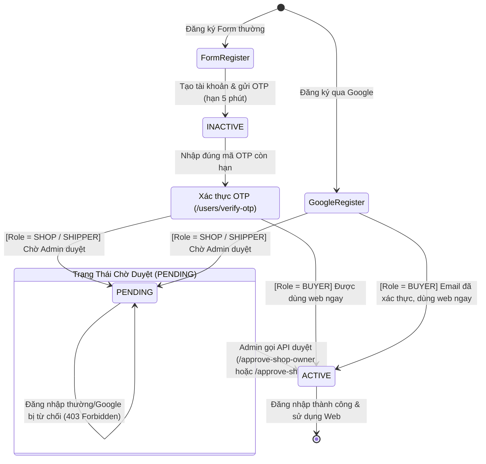
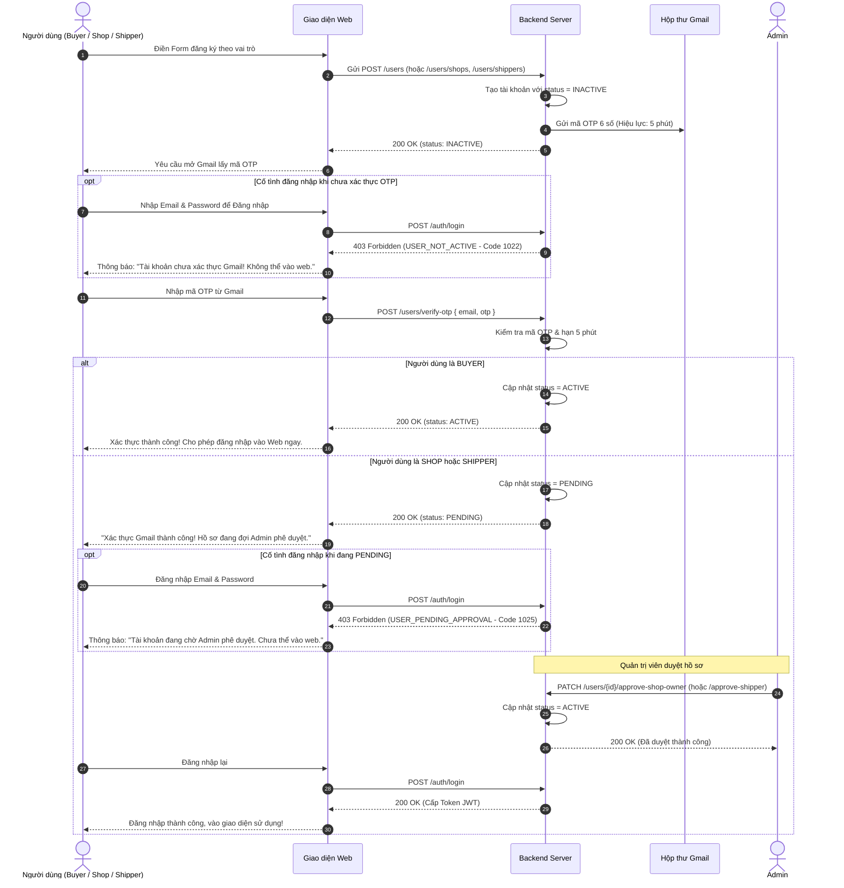
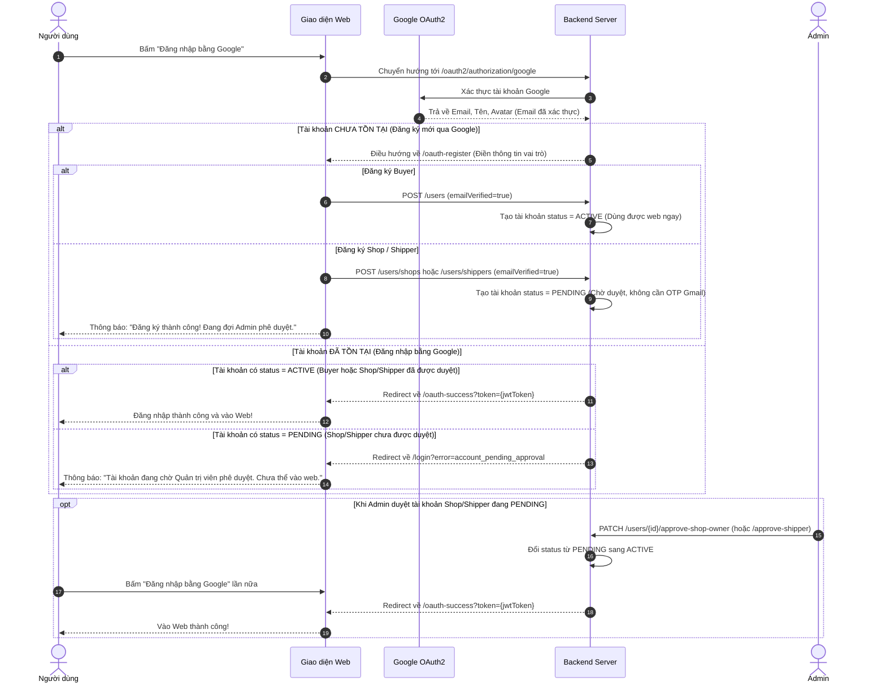

# Luồng Đăng Ký Người Dùng & Chuyển Đổi Trạng Thái (Registration Flow)

Tài liệu này đặc tả chi tiết quy trình đăng ký, xác thực và các bước chuyển đổi trạng thái tài khoản (`UserStatus`) cho **3 vai trò (Roles)** trong nền tảng APRP:
1. **Buyer (Người mua)**
2. **Shop (Cửa hàng / Nông dân)**
3. **Shipper (Người giao hàng)**

---

## 1. Thời Gian Hết Hạn Mã Xác Thực OTP Gmail

- **Thời gian hết hạn:** **Đúng 5 phút** (300 giây).
- **Vị trí cấu hình trong mã nguồn:** [`OtpServiceImpl.java` dòng 38](file:///d:/Desktop/SP26/Finaldoan/Code/BE/BE_CapNong/src/main/java/com/sang/be_capnong/service/impl/OtpServiceImpl.java#L38)
  ```java
  LocalDateTime now = LocalDateTime.now();
  LocalDateTime expirationTime = now.plusMinutes(5);
  ```
- Mã OTP gồm **6 chữ số ngẫu nhiên** được gửi qua email. Nếu nhập sau 5 phút, hệ thống sẽ từ chối với mã lỗi `1020 OTP_EXPIRED`.

---

## 2. Mô Tả Chi Tiết Từng Role Khi Đăng Ký & Trạng Thái Thay Đổi

Trong hệ thống, người dùng có các trạng thái (`UserStatus`):
- `INACTIVE`: Tài khoản vừa tạo, **chưa xác thực Gmail OTP**. Không được phép đăng nhập vào web.
- `PENDING`: Tài khoản đã xác thực Gmail, nhưng **đang chờ Quản trị viên (Admin) xét duyệt hồ sơ**. Không được phép đăng nhập vào web.
- `ACTIVE`: Tài khoản **đã kích hoạt đầy đủ**. Được phép đăng nhập và sử dụng toàn bộ chức năng trên web.
- `LOCKED`: Tài khoản bị tạm khóa bởi Admin. Không được phép đăng nhập.

---

### 2.1. Role BUYER (Người mua hàng)

#### A. Đăng ký thông thường (Điền form trên web):
1. **Bước 1 - Gửi form đăng ký:** Người dùng điền thông tin (Email, Mật khẩu, Họ tên, SĐT, Địa chỉ).
   - **Trạng thái tài khoản:** Khởi tạo ở trạng thái **`INACTIVE`**.
   - Hệ thống tự sinh mã OTP 6 số và gửi về Gmail của Buyer (hạn 5 phút).
   - **Nếu Buyer cố đăng nhập lúc này:** Hệ thống từ chối đăng nhập với mã lỗi `1022 USER_NOT_ACTIVE` (HTTP 403 Forbidden). **Không thể vào web**.
2. **Bước 2 - Xác thực OTP Gmail:** Người dùng mở Gmail lấy OTP và gọi API xác thực (`POST /users/verify-otp`).
   - **Trạng thái tài khoản chuyển đổi:** Từ **`INACTIVE`** $\rightarrow$ chuyển sang **`ACTIVE`**.
3. **Bước 3 - Sử dụng web:**
   - Buyer **không cần Admin duyệt**.
   - Khi trạng thái là `ACTIVE`, Buyer có thể đăng nhập ngay qua `/auth/login` để lấy JWT Token và truy cập đầy đủ các chức năng mua nông sản.

#### B. Đăng ký / Đăng nhập qua Google (GG):
- Vì tài khoản Google đã được Google xác thực email từ trước, nên cờ `emailVerified = true`.
- **Trạng thái tài khoản:** Tạo ngay ở trạng thái **`ACTIVE`**.
- Buyer **không cần mã OTP Gmail** và **không cần Admin duyệt** $\rightarrow$ Được cấp Token và vào web sử dụng ngay lập tức.

---

### 2.2. Role SHOP (Cửa hàng / Nông dân)

#### A. Đăng ký thông thường (Điền form trên web):
1. **Bước 1 - Gửi form đăng ký:** Chủ shop điền thông tin (Tên shop, mô tả, STK ngân hàng, SĐT, địa chỉ...).
   - **Trạng thái tài khoản:** Khởi tạo ở trạng thái **`INACTIVE`**.
   - Hệ thống gửi mã OTP 6 số về Gmail của Shop (hạn 5 phút).
   - **Nếu Shop cố đăng nhập lúc này:** Bị chặn với lỗi `1022 USER_NOT_ACTIVE`. **Không thể vào web**.
2. **Bước 2 - Xác thực OTP Gmail:** Shop nhập mã OTP để xác thực email.
   - **Trạng thái tài khoản chuyển đổi:** Từ **`INACTIVE`** $\rightarrow$ chuyển sang **`PENDING`** (Chờ Admin duyệt).
   - **Nếu Shop cố đăng nhập khi đang `PENDING`:** Hệ thống từ chối với lỗi `1025 USER_PENDING_APPROVAL` (HTTP 403 Forbidden). Thông báo *"Tài khoản đang chờ Admin phê duyệt hồ sơ"*. **Chưa được vào web**.
3. **Bước 3 - Admin phê duyệt hồ sơ:**
   - Quản trị viên kiểm tra thông tin cửa hàng và gọi API duyệt: `PATCH /users/{userId}/approve-shop-owner`.
   - **Trạng thái tài khoản chuyển đổi:** Từ **`PENDING`** $\rightarrow$ chuyển sang **`ACTIVE`** (Đồng thời cờ `shopActive = true`).
4. **Bước 4 - Sử dụng web:**
   - Sau khi trạng thái là `ACTIVE`, Shop đăng nhập thành công vào web, có quyền đăng bán sản phẩm, quản lý kho hàng và xử lý đơn hàng.

#### B. Đăng ký / Đăng nhập qua Google (GG):
1. Shop chọn đăng ký bằng Google $\rightarrow$ Google xác thực email sẵn.
2. **Trạng thái tài khoản:** Khởi tạo ngay ở trạng thái **`PENDING`** (Bỏ qua bước OTP Gmail).
3. **Khi đăng nhập bằng Google:**
   - Nếu tài khoản vẫn đang **`PENDING`** (chưa duyệt) $\rightarrow$ Hệ thống chuyển hướng về `/login?error=account_pending_approval`, **không cấp Token và không cho vào web**.
   - **Chỉ cần Admin duyệt** (`PATCH /users/{userId}/approve-shop-owner`) chuyển status thành **`ACTIVE`** $\rightarrow$ Đăng nhập bằng Google sẽ được cấp Token và vào web sử dụng bình thường.

---

### 2.3. Role SHIPPER (Tài xế giao hàng)

#### A. Đăng ký thông thường (Điền form trên web):
1. **Bước 1 - Gửi form đăng ký:** Shipper điền thông tin (Biển số xe, SĐT, CMND/CCCD, ảnh giấy tờ...).
   - **Trạng thái tài khoản:** Khởi tạo ở trạng thái **`INACTIVE`**.
   - Hệ thống gửi mã OTP 6 số về Gmail của Shipper (hạn 5 phút).
   - **Nếu cố đăng nhập:** Bị chặn với lỗi `1022 USER_NOT_ACTIVE`. **Không thể vào web**.
2. **Bước 2 - Xác thực OTP Gmail:** Shipper nhập mã OTP xác thực email.
   - **Trạng thái tài khoản chuyển đổi:** Từ **`INACTIVE`** $\rightarrow$ chuyển sang **`PENDING`** (Chờ Admin duyệt hồ sơ tài xế).
   - **Khi đang `PENDING`:** Cố đăng nhập sẽ bị từ chối với lỗi `1025 USER_PENDING_APPROVAL`. **Chưa được vào web**.
3. **Bước 3 - Admin phê duyệt hồ sơ:**
   - Quản trị viên kiểm tra biển số xe, thông tin pháp lý và gọi API duyệt: `PATCH /users/{userId}/approve-shipper`.
   - **Trạng thái tài khoản chuyển đổi:** Từ **`PENDING`** $\rightarrow$ chuyển sang **`ACTIVE`**.
4. **Bước 4 - Sử dụng web:**
   - Sau khi trạng thái là `ACTIVE`, Shipper đăng nhập thành công vào web/app để nhận đơn vận chuyển.

#### B. Đăng ký / Đăng nhập qua Google (GG):
1. Shipper chọn đăng ký bằng Google $\rightarrow$ Email đã được xác thực sẵn.
2. **Trạng thái tài khoản:** Khởi tạo ngay ở trạng thái **`PENDING`** (Không cần gửi OTP).
3. **Khi đăng nhập bằng Google:**
   - Nếu Admin chưa duyệt (status là **`PENDING`**) $\rightarrow$ Bị chặn, không cấp Token vào web.
   - **Chỉ cần Admin duyệt** thành **`ACTIVE`** $\rightarrow$ Đăng nhập bằng Google thành công và vào web sử dụng ngay.

---

## 3. Bảng Tổng Hợp Chuyển Đổi Trạng Thái (Status Matrix)

| Vai trò (Role) | Hình thức đăng ký | Ban đầu | Sau khi nhập OTP Gmail | Sau khi Admin duyệt | Được vào Web khi nào? |
| :--- | :--- | :---: | :---: | :---: | :--- |
| 🛒 **BUYER** | Đăng ký Form thường | `INACTIVE` | `ACTIVE` | *(Không cần)* | **Ngay sau khi Verify OTP Gmail** |
| 🛒 **BUYER** | Đăng ký Google (GG) | `ACTIVE` | *(Không cần)* | *(Không cần)* | **Ngay lập tức** |
| 🏪 **SHOP** | Đăng ký Form thường | `INACTIVE` | `PENDING` | `ACTIVE` | **Verify Gmail XONG + Đợi Admin duyệt** |
| 🏪 **SHOP** | Đăng ký Google (GG) | `PENDING` | *(Không cần)* | `ACTIVE` | **Chỉ cần đợi Admin duyệt** |
| 🚚 **SHIPPER** | Đăng ký Form thường | `INACTIVE` | `PENDING` | `ACTIVE` | **Verify Gmail XONG + Đợi Admin duyệt** |
| 🚚 **SHIPPER** | Đăng ký Google (GG) | `PENDING` | *(Không cần)* | `ACTIVE` | **Chỉ cần đợi Admin duyệt** |

---

## 4. Sơ Đồ Trực Quan (Mermaid Diagrams)

### 4.1. Sơ đồ Chuyển đổi Trạng thái Tổng quát (State Diagram)



---

### 4.2. Sơ đồ Tuần tự: Đăng ký Thông thường (Cả 3 Role)



---

### 4.3. Sơ đồ Tuần tự: Đăng ký & Đăng nhập bằng Google (GG)



---

## 5. Danh Sách API Liên Quan Đến Luồng Đăng Ký

### 5.1. API Đăng ký tài khoản
- **Buyer:** `POST /users`
- **Shop:** `POST /users/shops`
- **Shipper:** `POST /users/shippers`
- *Ghi chú:* Nếu đăng ký thường, gửi `emailVerified: false`. Nếu qua Google, gửi `emailVerified: true`.

### 5.2. API Xác thực OTP Gmail
- **Endpoint:** `POST /users/verify-otp`
- **Request Body:**
  ```json
  {
    "email": "user@example.com",
    "otp": 123456
  }
  ```
- **Thời hạn OTP:** 5 phút. Quá hạn trả về lỗi `1020 OTP_EXPIRED`.

### 5.3. API Gửi lại OTP Gmail
- **Endpoint:** `POST /users/resend-otp`
- **Request Body:** `{ "email": "user@example.com" }`
- **Quy tắc:** Chỉ tài khoản đang `INACTIVE` mới được phép gửi lại. Nếu đã `PENDING` hoặc `ACTIVE` sẽ báo lỗi `1023 USER_ALREADY_ACTIVE`.

### 5.4. API Phê duyệt tài khoản (Dành cho Admin)
- **Duyệt Shop:** `PATCH /users/{userId}/approve-shop-owner` (Chuyển `PENDING` $\rightarrow$ `ACTIVE`, kích hoạt `shopActive`).
- **Duyệt Shipper:** `PATCH /users/{userId}/approve-shipper` (Chuyển `PENDING` $\rightarrow$ `ACTIVE`).

### 5.5. API Đăng nhập
- **Endpoint:** `POST /auth/login`
- **Kiểm tra trạng thái:**
  - `status == INACTIVE`: Lỗi `1022 USER_NOT_ACTIVE` (Chưa xác thực OTP Gmail).
  - `status == PENDING`: Lỗi `1025 USER_PENDING_APPROVAL` (Đang chờ Admin duyệt).
  - `status == LOCKED`: Lỗi `1026 USER_LOCKED` (Tài khoản bị khóa).
  - `status == ACTIVE`: Cấp JWT Token thành công.
